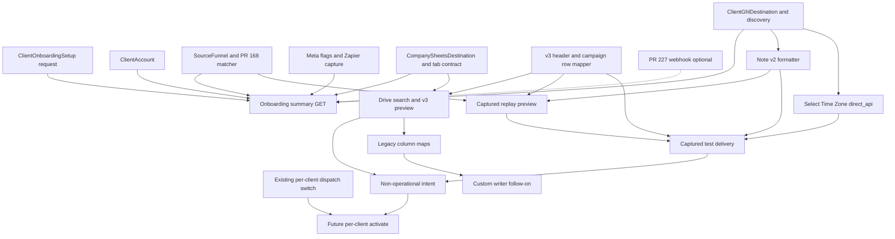

# Client onboarding v2 — Admin C.O.C. workspace contract

Design only. This document does not deploy, merge, toggle flags, change production
accounts, mutate lead data, resend webhooks, or write to Google or GoHighLevel.

Reviewed against `origin/master` `15cafc129c2768fc8034a0dcbcdc1ec137e77c69`
(Monday, October 26, 2026, 8:39 AM ET, the merge of PR #225) and open PR #227
at `f9c7e801db7e92a7b3d50369c9fd1c463614ff86`.

The workspace is one Admin C.O.C. surface per `ClientAccount`. It composes
sources of truth that already exist. It does not create a second client
registry, a second Sheets writer, a second routing matcher, or a second GHL
contact client.

`ClientOnboardingSetup` stays an administrative request. A setup choice is not
a connected sheet, a confirmed source, a GHL location, or a live switch.

Amended on draft PR #228. The current correction is three contracts:

- Reconcile of an uncertain Sheets or GHL result records the operator's evidence and does not authorize another external send.
- A field-mapping test appends only to a client-bound worksheet whose header is the exact 35 v3 columns. The four-column Canary worksheet is not that target.
- The note renders answers intake stored. Full Q&A completeness requires the intake evidence audit in section E.

The earlier amendment, parent head `eddd0e0c501b97b239787baa597bc547d16465e7`, added the executable captured-lead test, note contract `sa360_lead_note_v2`, Select Time Zone proof, the future per-client activation step, and the MVP cut. This document does not enable a flag or send a test.

## MVP cut

Ship the exact-v3 path first. The legacy custom writer is a follow-on and
must not block these steps.

1. Bind the existing `Campaign Leads` tab when preview classifies it
   `v3_exact_header`. Use the existing bind route and the existing v3 row
   mapper.
2. Link the confirmed LeadCapture `SourceFunnel` for the published form.
   Read `linked`, `observed`, and `routing_matched` from section D.
3. Verify GHL with location API: contact identity, the
   `sa360_lead_note_v2` body for every stored approved answer, and enrollment
   in the client's existing workflow named `Select Time Zone`. Full Q&A
   completeness waits on the intake evidence audit. PR #227 is an optional
   weaker mode. It is not a blocker for this step.
4. Run one controlled `captured_event_delivery` for a tenant-matched event
   whose contact is a verified test identity, onto an exact-v3 worksheet.
   Preview remains available and sends nothing. An uncertain outcome stays
   in manual review and is not sent again.
5. After the readiness intent is `ready_for_operator`, a separate future
   route may turn on this client's existing campaign switch. It does not
   change global flags or any other client.
6. Legacy sheet mapping, including `VET Web Form`, stays behind
   `SA360_CLIENT_ONBOARDING_V2_CUSTOM_WRITER_ENABLED` and the custom-writer
   PR.

## Matt's workflow, and the product boundary

| Observed step | What SA360 records | What this contract does not do |
| --- | --- | --- |
| Locate or duplicate a webform or funnel | Confirmed `SourceFunnel` for the published LeadCapture identity, or the existing Facebook page+form association | Duplicate a form inside LeadCapture or Meta |
| Configure a Zapier source and filters | The external Zap remains the delivery path until a native destination is armed | Disable, edit, or replace the Zap. No new filter engine |
| Inspect the client's existing spreadsheet | Drive search inside the approved parent or linked client folder, pasted-id resolution, tab preview | Fetch an arbitrary pasted URL. Create or rewrite tabs during preview |
| Format dates and map fields | Versioned map, or the v3 exact-header fast path | Calculate age from date of birth. Copy Primary Reason into Primary Concern |
| Connect LeadConnector and open the existing Select Time Zone workflow | The discovered workflow id stored on `ClientGhlDestination`, with `workflowTriggerMode` `direct_api` for that client | Create a workflow, create custom fields, or hardcode a workflow id |
| Submit a test from the published form, then choose Test delivery again | The stored `SourceLeadEvent`, then an optional executable test run | Re-POST the provider webhook, or create a second canonical event |
| Inspect the GHL contact, its notes, and the spreadsheet | Separate receipts for HTTP acceptance, contact, note, enrollment, and downstream execution | Treat those proofs as the same fact |

## Worked example: preexisting workbook

The acceptance fixture, not a production file, has four tabs:

| Tab | Rows | Onboarding classification | May be the campaign target in v2 |
| --- | --- | --- | --- |
| `VET Web Form` | 15-column legacy header, five historical lead rows | `legacy_custom_required` | Only after a published custom map and the custom writer. Appending never rewrites those rows or row 1 |
| `Daily Stats` | irrelevant | `stats_excluded` | No |
| `Weekly Stats` | irrelevant | `stats_excluded` | No |
| `Campaign Leads` | empty body; row 1 is the 35 `company_sheets_campaign_v3` headers in order | `v3_exact_header` | Yes, after the existing explicit bind. Fast path does not auto-save |

`company_sheets_campaign_v3` is 35 columns, counted from
`COMPANY_SHEETS_V3_HEADER` in `packages/shared/src/company-sheets-column-template.ts`.
Niche selection does not change that header. The safe path for this workbook is
to bind `Campaign Leads` through the existing campaign bind. `VET Web Form`
stays unbound until the custom-writer PR. Stats tabs are not selectable.

Header cells named below are the only legacy names this contract requires.
The other thirteen legacy headers are whatever the preview snapshot reads.
Do not invent them in code.

## Closed vocabulary

Agents implement these strings. Do not add a synonym for the same fact.

### Proof kinds

`linked`, `observed`, `routing_matched`, and `delivery` are four fields on
every source. One field does not imply the next.

| Kind | Satisfied when | Not satisfied by |
| --- | --- | --- |
| `linked` | `SourceFunnel.associationStatus` is `confirmed` and `originClientAccountId` is this client | A suggestion, a display name, a UTM value, a route key |
| `observed` | `firstSeenAt` is set, or a stored event identity-matches this funnel | A synthetic Sheets row, a column-mapping preview, the internal pilot lead |
| `routing_matched` | A stored event has status `routing_matched`, `clientAccountIdResolved` is this client, and authority is an exact `CampaignRoutingRule` or `confirmed_source_association` for this funnel | A loose UTM or keyword rule. Report that as `loose_rule_not_source_proof` |
| `delivery` | A post-cutoff production Sheets job succeeded, or a post-cutoff production GHL receipt succeeded, for that event | A permission probe, a pre-cutoff event, a Zapier write SA360 did not perform, an HTTP 2xx, a note id used as workflow proof, or an `onboarding_captured_test` receipt |

Meta capture-only can be `linked` and `observed` with `routing_matched` false
and `delivery` false. That is complete for capture-only. It is not a routing
failure and it is not delivery proof.

### Sheet classifications

`v3_exact_header`, `v3_prefix_with_extra_columns`, `known_schema_exact`,
`compatible_empty`, `legacy_custom_required`, `stats_excluded`, `not_grid`,
`incompatible`.

### GHL modes

`unset`, `location_api`, `inbound_webhook`, `external_zapier`.

### Test-run kinds

`preview`, `captured_event_replay`, `captured_event_delivery`, `synthetic_delivery`.

`captured_event_replay` previews a stored event and sends nothing.
`captured_event_delivery` is the authorized send. It is a different kind, not
`execute: true` on the preview kind.

### Receipt kinds

`permission_probe`, `synthetic_row`, `captured_test`, `natural_event`.

### GHL proof facts

`http_accepted`, `contact_upserted`, `note_persisted`, `workflow_enrolled`,
`downstream_executed`. A later fact does not follow from an earlier one.

### Destination ids

`google_sheets`, `ghl_location_api`, `ghl_inbound_webhook`.

## A. Summary and readiness

`GET /admin/v1/clients/:clientAccountId/onboarding`

Flag `SA360_CLIENT_ONBOARDING_V2_READ_ENABLED` must be exactly `true`. Otherwise
`404` with `error: "onboarding_read_disabled"`. The handler reads Postgres
only. It does not call Google, GHL, Meta, or LeadCapture.

`clientAccountId` matches `^[A-Za-z0-9][A-Za-z0-9_-]{0,127}$`. Unknown id is
`404` `client_not_found`.

```json
{
  "ok": true,
  "contractVersion": "client_onboarding_v2",
  "client": {
    "clientAccountId": "alex_gross",
    "clientDisplayName": "Alex Gross",
    "status": "onboarding",
    "primaryNicheKeys": ["vet"],
    "primaryProductTypes": []
  },
  "setupRequest": {
    "present": true,
    "status": "draft",
    "revision": 1,
    "destinationChoice": "both",
    "operational": false
  },
  "sources": [],
  "sheets": {
    "destinationSaved": false,
    "spreadsheetId": null,
    "campaignTab": null,
    "campaignDispatchEnabled": false,
    "campaignDispatchNotBefore": null,
    "agedDispatchEnabled": false,
    "writeReadiness": null,
    "deliveryExecution": null,
    "uncertainJob": false
  },
  "ghl": {
    "mode": "unset",
    "locationIdPresent": false,
    "workflowTriggerMode": null,
    "workflowIdPresent": false,
    "inboundWebhookArmed": false,
    "notesEnabled": false,
    "notesContractVersion": null
  },
  "externalZapier": {
    "preserved": true,
    "replacedByNative": false
  },
  "gates": [],
  "liveActivationPerformedByOnboarding": false,
  "blockers": []
}
```

`setupRequest` is the `ClientOnboardingSetup` projection. `operational` is
always `false`. `sources` is the source-proof array from section D, not a copy
stored on the setup document.

`sheets.campaignDispatchEnabled` and the cutoff are read from
`CompanySheetsDestination`. This GET does not change them. A pilot that is
already on stays on. Aged dispatch is reported and is not a campaign gate.

`gates[].id` is one of:

- `leadcapture_linked`
- `leadcapture_observed`
- `leadcapture_routing_matched`
- `meta_capture_only_acknowledged`
- `meta_linked`
- `meta_routing_matched`
- `sheets_destination_saved`
- `sheets_control_verified`
- `sheets_tab_explicitly_bound`
- `sheets_header_dispatch_ready`
- `sheets_custom_map_published`
- `sheets_permission_probe`
- `sheets_writer_receipt`
- `sheets_no_uncertain_job`
- `ghl_mode_explicit`
- `ghl_location_configured`
- `ghl_webhook_stored_disabled`
- `ghl_note_contract_ready`
- `zapier_not_disabled`
- `aged_not_activated_by_onboarding`

Each gate is `{ "id", "required", "satisfied", "evidenceIds": [] }`.
`required` depends on the selected modes. A client with no Meta source does
not require the Meta gates. A client whose GHL mode is `external_zapier` does
not require location or webhook gates. Sheets gates are required only when
the destination profile selects Sheets. Unselected destinations stay visible
and `required: false`.

`liveActivationPerformedByOnboarding` stays `false`. Arming campaign dispatch
remains `POST /admin/v1/clients/:clientAccountId/google-sheets/dispatch-activation`.
This workspace does not call it.

## B. Drive search, pasted folder, sheet selection

Pasted identifiers stay on the current routes. Those routes parse an id out of
a spreadsheet or folder URL and then call Drive. They do not HTTP-fetch the
pasted URL.

| Existing route | Role in v2 |
| --- | --- |
| `POST /admin/v1/clients/:clientAccountId/google-sheets/folder/resolve` | Resolve one pasted folder id or folder URL |
| `POST .../google-sheets/folder` | Create or link the display-name client folder. Unchanged claim behavior |
| `GET .../google-sheets/folder/spreadsheets` | List spreadsheets already under the linked client folder |
| `POST .../google-sheets/resolve` | Resolve one pasted spreadsheet id or URL |
| `POST .../google-sheets/create` | Create a spreadsheet in a verified folder |
| `PUT .../google-sheets/destination` | The only save. Search and preview do not save |
| `POST .../google-sheets/tabs/inspect` | Unchanged. Does not classify stats or legacy maps |
| `POST .../google-sheets/tabs/bind` | Unchanged v1/v2/v3 bind. Not used for a legacy header |

New reads use the existing setup flag `SA360_COMPANY_GOOGLE_SHEETS_ENABLED`.
They do not use the execution flag or the dispatch flag. They do not create
files, change parents, or call `permissions.create`.

### `POST /admin/v1/clients/:clientAccountId/onboarding/drive/search`

```json
{ "scope": "approved_parent", "query": "Alex", "pageToken": null }
```

`scope` is `approved_parent` or `client_folder`. `query` is 1–80 characters
after trim. The server builds the Drive query. The request is not Drive query
language. Search is the approved shared-drive parent, or the folder already
linked to this client. A shortcut is listed as `shortcut: true` and is not
followed. Trashed items are returned with `trashed: true` and
`selectable: false`.

```json
{
  "ok": true,
  "saved": false,
  "items": [
    {
      "id": "drive-file-id",
      "title": "Alex Gross",
      "mimeType": "application/vnd.google-apps.spreadsheet",
      "kind": "spreadsheet",
      "driveId": "approved-drive",
      "parents": ["approved-parent"],
      "trashed": false,
      "shortcut": false,
      "selectable": true
    }
  ],
  "nextPageToken": null
}
```

`saved` is always `false`. Selecting a hit is a later `PUT` to the existing
destination route, after resolve and control checks. A file that fails
`establishControl` is not selectable (`not_company_controlled`,
`unapproved_shared_drive`, `outside_approved_parent`, and the other current
control codes).

### `POST /admin/v1/clients/:clientAccountId/onboarding/sheets/preview`

```json
{ "spreadsheetId": "spreadsheet-id", "purpose": "campaign" }
```

`purpose` is `campaign` only in v2. Aged tabs stay on the export-package
header. The spreadsheet must pass `establishControl` for the company
connection. Preview reads worksheet metadata and `A1:ZZ2` plus the existing
column-A probe capped at `COMPANY_SHEETS_RECONCILE_ROW_CAP` (5000). It does
not call `values.update`, `values.append`, `spreadsheets.batchUpdate`, or
`permissions.create`.

```json
{
  "ok": true,
  "saved": false,
  "spreadsheetId": "spreadsheet-id",
  "spreadsheetTitle": "Alex Gross",
  "worksheets": [
    {
      "worksheetId": 0,
      "title": "Campaign Leads",
      "grid": true,
      "header": ["Date"],
      "headerColumnCount": 35,
      "historicalDataRows": "empty",
      "classification": "v3_exact_header",
      "fastPath": true,
      "deliveryEligible": true,
      "requiresExplicitSelection": true,
      "reasons": []
    }
  ]
}
```

`historicalDataRows` is `empty`, `has_rows`, or `truncated`. When the probe
reads every occupied column-A cell and the count of non-header rows is known,
also return `historicalDataRowCount`. Five legacy rows is `has_rows` with
count `5`. `truncated` is not a fast path and cannot be published as a map,
because the header check is incomplete (`reconcile_incomplete`).

Classification rules, applied in this order:

1. Title trimmed, case-insensitive, equal to `Daily Stats` or `Weekly Stats`
   → `stats_excluded`. `deliveryEligible: false`. `fastPath: false`. v2 has
   no override. `Weekly Statistics` is not this rule.
2. Not a grid → `not_grid`.
3. Header length is 35 and cell `i` equals `COMPANY_SHEETS_V3_HEADER[i]` with
   no trim and no case fold → `v3_exact_header`, `fastPath: true`. Empty body
   still matches. This is the Campaign Leads case.
4. Header is longer than 35 and the first 35 cells equal the v3 header →
   `v3_prefix_with_extra_columns`, `fastPath: false`. Tab inspect uses a
   prefix `sameHeader` and can classify that sheet as compatible. Dispatch
   readiness, campaign-test, and execute use exact length
   (`storedHeader.length === expectedHeader.length`, and `sameContractHeader`
   in the delivery service). Preview must not call a prefix match the fast
   path. Do not change either comparator in the onboarding PRs.
5. Header equals the v1 or v2 campaign header at exact length →
   `known_schema_exact`. Eligible for the existing bind. Not the v3 fast path.
6. Blank grid → `compatible_empty`. Eligible for the existing header
   provision. Not a legacy map.
7. Any other non-empty header, including a 15-column `VET Web Form` →
   `legacy_custom_required`, `fastPath: false`, `deliveryEligible: false`
   until a published map's header snapshot equals this header and the custom
   writer flag is on. Five historical rows do not block mapping. They block
   any rewrite.

`requiresExplicitSelection` is true whenever `deliveryEligible` is true.
Nothing in preview binds a tab or chooses a default worksheet. The first grid
is not a default. `VET Web Form` is not a default because it is a legacy
header. Stats tabs are excluded before eligibility.

API defaults agents must not "align":

- Tab bind omits `schemaVersion` → `company_sheets_campaign_v1`.
- `POST .../google-sheets/column-mapping` omits `schemaVersion` →
  `company_sheets_campaign_v3`.
- The admin panel state defaults to v3 and sends that value on bind and create.

Onboarding calls always send an explicit schema version. They do not depend
on either default.

## C. Versioned column map

A map is delivery projection for one client, one source scope, and one
worksheet. It is not an intake alias. Do not add headers to
`DEFAULT_SOURCE_FIELD_ALIASES`.

`reviewCompanySheetsColumnMapping` stays the v1/v2/v3 template review. It
keeps returning `customMapping: false`. Custom assignments are not posted to
that route.

### Identity

Unique published row: `(clientAccountId, sourceScope, spreadsheetId, worksheetId)`
where `sourceScope` is `shared`, or `funnel:{sourceFunnelId}`.

Writer precedence:

1. Published map whose `sourceFunnelId` is the event's matched funnel.
2. Published `shared` map for that spreadsheet and worksheet.
3. Bound schema `company_sheets_campaign_v3` (or v1/v2) with no custom map:
   the existing campaign row mapper.
4. Otherwise fail closed `mapping_required`. Do not append.

A draft is never used by the writer. Publishing a replacement requires the
previous published row to be `retired` first. `mapVersion` increments on that
scope and is copied onto the delivery job. A later edit does not change a job
already enqueued. The idempotency keys stay the current ones, so a new map
version does not deliver the same event again:

- Intent: `campaign:{clientAccountId}:{sourceLeadEventId}`
- Job: `lead:{clientAccountId}:{sourceLeadEventId}`

### Assignment

```json
{
  "sheetHeader": "Primary Reason",
  "target": { "kind": "v3_column", "header": "Primary Reason", "sourceField": "primary_reason" },
  "transform": "passthrough",
  "decision": "mapped",
  "explicit": true
}
```

`decision` is `mapped`, `unmapped`, or `ambiguous`. `transform` is
`passthrough`, `trim`, `date_america_new_york`, or `blank`.

`target.header` is one of the 35 v3 headers. `target.sourceField` is that
column's `sourceField`. The pair is checked against
`COMPANY_SHEETS_V3_COLUMNS`. A mismatched pair is `422` `unknown_target`.

Legacy output shape: the writer emits cells in `headerSnapshot` order. It does
not insert `delivery_row_id`, `client_account_id`, `source_lead_event_id`, or
`received_at` into a legacy header. Those identities stay on the job and row
tables. Schema version for that job is `company_sheets_campaign_custom_v1`.

Until the custom-writer PR, publish may store the map and must not write
`company_sheets_campaign_custom_v1` onto `CompanySheetsTabContract`. Today's
`companySheetsCampaignHeader` returns null for an unknown version, and bind
rejects it. Leaving the tab schema alone keeps dispatch fail-closed.

### Forbidden and ambiguous mappings

Normalize only for these rules: trim, lowercase, collapse whitespace, remove
whitespace around `/`.

| Normalized header | Rule |
| --- | --- |
| `age/dob` | `ambiguous`, code `ambiguous_age_or_dob`. Covers `Age/ DOB`, `Age/DOB`, and `Age / DOB`. Plain `Age` and plain `DOB` are not this rule |
| `primary reason` | May target only v3 `Primary Reason` / `primary_reason`. Targeting `Primary Concern` / `primary_concern` is `422` `primary_reason_is_not_primary_concern`. v2 has no override phrase |
| `primary concern` | May target only `Primary Concern` / `primary_concern` |

`Age/ DOB` cannot be published while `ambiguous`. The operator submits one
explicit decision:

- target `Age`, transform `passthrough` (an age; not parsed as a date)
- target `DOB`, transform `date_america_new_york` (a date; age is not calculated)
- `decision: "unmapped"`, transform `blank`

v3 fast path does not use this normalizer. `Age` and `DOB` are already
separate columns. The campaign mapper reads stored `consumer_age` and stored
`date_of_birth`. It does not derive one from the other. Primary Reason and
Primary Concern stay separate columns. That behavior is already in
`company-sheets-campaign-row.ts` and the alias registry. Custom maps must not
weaken it.

### Dates

`date_america_new_york` writes a date-only value as `MM/DD/YYYY` without
moving the calendar day. A timestamp with an offset is converted to
`America/New_York` and then formatted `MM/DD/YYYY`. A missing value stays
blank. Delivery time is not substituted. The v3 `Date` column remains the
generation timestamp from the existing mapper, not this legacy transform.

### Routes

Flag `SA360_CLIENT_ONBOARDING_V2_CONFIG_ENABLED` must be exactly `true`.
Otherwise `404` `onboarding_config_disabled`.

| Method and path | Effect |
| --- | --- |
| `GET /admin/v1/clients/:clientAccountId/onboarding/column-maps` | List drafts and published maps for this client. Query `worksheetId` optional |
| `POST .../onboarding/column-maps` | Create a draft from a preview header snapshot taken in this request. Does not trust a client-supplied header without re-reading the sheet |
| `PATCH .../onboarding/column-maps/:mapId` | Replace assignments. Body includes `expectedRevision` |
| `POST .../onboarding/column-maps/:mapId/publish` | Publish when every column is explicit and none are `ambiguous`, and the live header still equals the snapshot |
| `POST .../onboarding/column-maps/:mapId/retire` | Retire. Does not delete. Does not rewrite sheet cells |

Create body:

```json
{
  "requestId": "uuid",
  "spreadsheetId": "id",
  "worksheetId": 0,
  "sourceScope": "shared",
  "baseSchemaVersion": "legacy_custom"
}
```

`baseSchemaVersion` `company_sheets_campaign_v3` is rejected with
`use_existing_v3_bind` when preview is `v3_exact_header`. The fast path has
no custom map. `sourceScope` `funnel:{id}` requires that funnel's confirmed
origin to be this client.

Stale `expectedRevision` is `409` `revision_conflict`. Header drift since the
snapshot is `409` `header_changed`. Publish of an unresolved age column is
`422` `mapping_unresolved`.

`PUT /admin/v1/clients/:clientAccountId/onboarding/sheets-target` stores the
operator-selected spreadsheet id and worksheet gid independently. Campaign
delivery must already be paused. The request re-reads the live header. An
exact v1, v2, or v3 header binds that schema. Any other grid is saved as the
target and keeps the previous schema string until a custom map for that exact
header is published. `writeReadiness` becomes `not_verified`. Ready activation
intents for `google_sheets_campaign` become `blocked`. The campaign switch,
aged switch, and cutoff stay as they were. Row 1 is not rewritten.

### Append contract

The custom writer runs only when the bound campaign schema is
`company_sheets_campaign_custom_v1` and
`SA360_CLIENT_ONBOARDING_V2_CUSTOM_WRITER_ENABLED` is exactly `true` after
trim. An exact v1, v2, or v3 binding keeps `company-sheets-campaign-row.ts`.
A published map does not override that binding. Publishing a map, or selecting
a tab that already has a matching published map, is the explicit reconfigure.
Drafts do not change the campaign tab.

`CUSTOM_APPEND_CONTRACT` in `company-sheets-custom-row.ts`:

- `values.append` and `values.update` use RAW. Formula interpretation is refused.
- The write is one new row. Row 1 and existing data rows are never in the update range.
- A column whose header or row-2 cell begins with `=` is omitted, so the formula and any spill stay intact.
- Unmapped columns are an empty cell on the new row only.
- A header cell that is blank cannot be stored. `ClientSheetColumnMap.headerSnapshot` already requires every cell to be 1–200 characters. Draft creation returns `blank_header` and does not write the sheet. Duplicate non-blank headers stay `ambiguous` until the operator maps one and leaves the other unmapped.
- Columns past the saved snapshot are not written.
- A live header that is not an exact cell-for-cell match stops before `appendStartedAt` with `header_changed`. That stop is retryable and is not an uncertain append, so it does not hold the worksheet lock.
- When a formula column sits between mapped columns, the first segment is appended. Later segments are updated on the new row only when Google returns that row and the row number is at least 2. A missing range is `append_outcome_unknown` and stays uncertain.
- The job copies `column-map:{id}:v{version}` onto `contentSha256` together with the header and cell values. A later map edit does not change an enqueued job.
- Controlled tests and live campaign delivery use this published map. A future historical sync must use the same published map. That sync is not implemented here.

### Persistence

Auth/Account migration only. Additive tables:

`ClientSheetColumnMap`

- `id`, `clientAccountId` (cascade with the account)
- `sourceScope` string
- `spreadsheetId`, `worksheetId` int
- `mapVersion` int
- `status` `draft | published | retired`
- `baseSchemaVersion` string
- `headerSnapshot` Json string array
- `assignments` Json
- `revision` int
- `publishedAt`, `retiredAt`, `createdAt`, `updatedAt`
- partial unique index: one `published` row per client, source scope, spreadsheet, worksheet

`ClientOnboardingV2AuditEvent`

- append-only, `requestId` unique
- `historicalClientAccountId` retained if the account is rekeyed or deleted
- `actorLabel` from `x-sa360-admin-actor`, stored as an untrusted label
- `auth` always `admin_api_key` until staff identities exist

No backfill. No change to intake tables, inventory, orders, or pricing.
A draft does not change `CompanySheetsDestination` or `CompanySheetsTabContract`.
Publishing a map, or saving an existing-tab target, updates that client's
campaign tab only. It does not change dispatch switches or the cutoff.

## D. Source proof

`GET /admin/v1/clients/:clientAccountId/onboarding/source-proof`

Same read flag as the summary. No webhook resend. No call to
`pnpm source-intake:one-event-reconcile`. No routing recompute.

```json
{
  "ok": true,
  "sources": [
    {
      "sourceKind": "leadcapture",
      "sourceFunnelId": "funnel_id",
      "associationStatus": "confirmed",
      "identity": {
        "provider": "leadcapture_io",
        "providerFunnelId": null,
        "parentUrlKey": "go.example.com/alex",
        "pageSlug": null
      },
      "proofs": {
        "linked": { "satisfied": true, "at": "2026-10-26T14:00:00.000Z" },
        "observed": {
          "satisfied": false,
          "at": null,
          "sourceLeadEventId": null,
          "intakeStage": null,
          "captureOnly": false
        },
        "routingMatched": {
          "satisfied": false,
          "authority": null,
          "routingDryRunDecisionId": null,
          "matchedRuleId": null,
          "looseRuleIgnored": null
        },
        "delivery": {
          "satisfied": false,
          "sheetsJobId": null,
          "ghlReceiptId": null
        }
      }
    }
  ]
}
```

`sourceKind` is `leadcapture`, `meta_lead_ads`, or `zapier_facebook`.

LeadCapture identity is the existing matcher: provider form id, then
`parentUrlKey`, then a single hosted slug on `my.leadcapture.io`. Route keys
are not a lookup. This GET does not import a second matcher. It reads
`SourceFunnel` and stored `routingResultJson.sourceAssociation`.

Meta direct intake and Zapier capture stay distinct:

| Path | Flags today | What proof it can produce |
| --- | --- | --- |
| Meta notification retained | `SA360_META_LEAD_ADS_INTAKE_ENABLED` | Not observed contact fields unless fetch ran |
| Meta Graph field fetch, routing off | intake on, `SA360_META_LEAD_ADS_ROUTING_ENABLED` off. `captureMode = !routingEnabled` in `meta-leadgen-fetch.service.ts` | `observed`, `captureOnly: true`. Routing and delivery stay false. `FACEBOOK_DIRECT_INTAKE_ENABLED` is the legacy alias that turns intake, Graph fetch, and routing all on. v2 does not turn that alias on |
| Meta routing on | `SA360_META_LEAD_ADS_ROUTING_ENABLED` | Can satisfy `routing_matched` through the same dry-run as LeadCapture. Still not delivery |
| Zapier Facebook capture | `SA360_FACEBOOK_CAPTURE_INTAKE_ENABLED` | `observed` only. `delivery.thisRequestAttempted` is false (`capture_only_intake_does_not_deliver`). Association is `fbpage:{pageId}:fbform:{formId}` on `SourceFunnel` |
| Confirmed LeadCapture association | none of the delivery flags | `routing_matched` when no exact rule won. PR #168. Delivery stays off |

`delivery.satisfied` for Sheets requires a `CompanySheetsDeliveryJob` with
`kind: "lead"`, `status: "succeeded"`, this client, and this
`sourceLeadEventId`, whose intent was created at or after
`campaignDispatchNotBefore`. A canary job, a campaign-test synthetic row, and
`spreadsheetDeliveredAt` do not count.

`delivery.satisfied` for GHL is section E. Webhook HTTP 2xx and a location-API
note are different receipt ids. Neither satisfies Sheets.

## E. GHL destination and notes

Two implementations exist. Onboarding must name which one a client uses.

| Mode | Source of truth | What it does today | Note proof |
| --- | --- | --- | --- |
| `location_api` | `ClientGhlDestination` | Contact upsert, custom fields, tags, optional opportunity, workflow via `workflowTriggerMode` (`none`, `direct_api`, `tag_trigger`). Default remains `tag_trigger`. Direct API is `POST /contacts/:contactId/workflow/:workflowId` only when `destinationWorkflowIdGhl` is set | SA360 can post one note after the contact id is known |
| `inbound_webhook` | `DeliveryTarget` `adapterKey: "webhook.generic.v1"` | Not on master. PR #227 posts JSON after routing commit when the global flag, `enabled`, `campaignDispatchEnabled`, and `campaignDispatchNotBefore` are all set | HTTP 2xx is not a note. `workflowIdKnown: false` |
| `external_zapier` | none in SA360 | The Zap keeps delivering | SA360 has no receipt |

`tag_trigger` adds `SA360::TRIGGER::NEW_LEAD` and does not call the workflow
API. A receipt for that mode says `workflowApiCalled: false` and
`triggerTagPlanned: true`. It does not claim the workflow ran.

Location id, workflow id, assigned user, and trigger mode stay on
`ClientGhlDestination` and the existing `PATCH /admin/v1/clients/:clientAccountId/ghl-destination`.
Do not copy them onto a second column. Config discovery stays
`POST /admin/v1/clients/:clientAccountId/ghl-config`.

### Profile

`GET` and `PUT /admin/v1/clients/:clientAccountId/onboarding/destinations`

PUT body:

```json
{
  "requestId": "uuid",
  "expectedRevision": 0,
  "sheetsSelected": true,
  "ghlMode": "location_api",
  "notesEnabled": false
}
```

PUT does not set `deliveryEnabled`, `clientCutoverApproved`,
`campaignDispatchEnabled`, `agedDispatchEnabled`, target `enabled`, or any
cutoff. `notesEnabled: true` requires `ghlMode: "location_api"` and stores
`notesContractVersion: "sa360_lead_note_v2"`. Other modes force
`notesEnabled: false`. `sa360_lead_note_v1` is withdrawn. Do not implement it.

### Disabled webhook target

`PUT /admin/v1/clients/:clientAccountId/onboarding/ghl-webhook-target`

```json
{
  "requestId": "uuid",
  "endpointUrl": "https://services.leadconnectorhq.com/hooks/example"
}
```

The URL must be `https`, with no username, password, or embedded credentials.
The row is created or updated only in this shape:

- `adapterKey`: `webhook.generic.v1`
- `enabled`: false
- `isPrimary`: false
- `isRequired`: false
- `configMetadataJson.endpointUrl`: the URL
- `configMetadataJson.campaignDispatchEnabled`: false
- `configMetadataJson.campaignDispatchNotBefore`: null

`listEnabledDeliveryTargetsForClient` ignores a disabled row, so LF2 planning
does not gain an instruction. If an enabled `webhook.generic.v1` row already
exists for this client, the PUT returns `409` `webhook_target_already_armed`
and does not change it. The response redacts the URL in logs. The admin JSON
may return the URL to an ADMIN session only.

This shape is what PR #227 refuses to send (`not_armed`). Saving it cannot
become live delivery when `SA360_GHL_INBOUND_WEBHOOK_ENABLED` is later turned
on. Arming is a separate, unauthorized route that this design does not add.

### Select Time Zone workflow

Matt's initial workflow is the workflow that already exists in the client
location and is named `Select Time Zone`. Downstream steps inside that
workflow stay in GHL. SA360 does not create custom fields, edit the workflow,
or embed a workflow id in source code.

`GET /admin/v1/clients/:clientAccountId/onboarding/ghl-workflows` reads the
workflows already returned by GHL config discovery (`GhlDiscoveredWorkflow`:
`id`, `name`, `status`, `type`). It does not create a workflow. Name match is
trim, case-insensitive equality with `select time zone`.

| Discovery result | Response |
| --- | --- |
| One match | `workflowMatch: "unique"`, plus that id and name |
| None | `workflow_not_found` |
| More than one | `workflow_ambiguous`, with the ids and names, and no selected id |

`PUT /admin/v1/clients/:clientAccountId/onboarding/ghl-workflow`

```json
{
  "requestId": "uuid",
  "expectedRevision": 1,
  "discoveredWorkflowId": "id-from-the-get",
  "discoveredName": "Select Time Zone"
}
```

The server re-reads discovery and accepts the id only when that snapshot still
contains it and the name still matches. It then writes the existing
`ClientGhlDestination.destinationWorkflowIdGhl` and sets this client's
`workflowTriggerMode` to `direct_api`. It does not change
`deliveryEnabled`, `clientCutoverApproved`, dispatch switches, or any other
client. The default for a destination that has not been through this PUT
remains `tag_trigger`. `tag_trigger` can prove that SA360 planned the tag
`SA360::TRIGGER::NEW_LEAD`. It cannot prove enrollment in Select Time Zone.

Recommended path for the MVP is `location_api` plus this `direct_api`
enrollment. It is the smallest path that can prove contact identity, the full
note, and initial workflow entry with the adapter already on master. Inbound
webhook mode stays available and is not required.

### What each GHL mode can prove

| Proof | `location_api` with `direct_api` | `location_api` with `tag_trigger` | `inbound_webhook` (PR #227) |
| --- | --- | --- | --- |
| `http_accepted` | Each GHL response status | Each GHL response status | Webhook response status |
| `contact_upserted` | Contact id from the upsert response | Contact id from the upsert response | Unproven. A 2xx does not identify a contact |
| `note_persisted` | Note id from `POST /contacts/:contactId/notes` for every note part | Same, when notes are enabled | Unproven. The #227 body has no note |
| `workflow_enrolled` | 2xx from `POST /contacts/:contactId/workflow/:workflowId` for the discovered Select Time Zone id | Unproven. A trigger tag is not enrollment | Unproven. `workflowIdKnown` is false |
| `downstream_executed` | Unproven by the enrollment 2xx. Requires operator attestation or a later read-only probe | Unproven | Unproven |

These modes are not interchangeable. An HTTP 2xx never proves
`downstream_executed`. Enrollment 2xx never proves the workflow's later
actions ran. PR #227 does not block the location API path.

Operator attestation, with no GHL call:

`POST /admin/v1/clients/:clientAccountId/onboarding/ghl-external-evidence`

```json
{
  "requestId": "uuid",
  "testRunId": "run_id",
  "kind": "downstream_executed",
  "observation": "Contact entered Select Time Zone and the first GHL action completed.",
  "confirmation": "RECORD EXTERNAL GHL OBSERVATION"
}
```

`kind` is `note_persisted`, `workflow_enrolled`, or `downstream_executed`.
The receipt uses `evidenceClass: "operator_attestation"`. It does not upgrade
an HTTP status. MVP activation displays `downstream_executed` and does not
require it. Whether the first live client should require that attestation is
a product decision recorded in the acceptance doc. The test and note PRs do
not wait on it.

### Note body `sa360_lead_note_v2`

Pure functions `listApprovedFormAnswers` and `buildOnboardingLeadNote` live
in the GHL delivery adapter package. Do not reuse the Agent Workspace outcome
note in `ghl-sync.service.ts`.

Title: `SA360 lead`

The body has two blocks. The summary block is stable. The second block is
every approved form answer, in capture order.

Summary lines use `not supplied` when that identity field was not stored.
`Primary reason` reads `primary_reason` only. `Primary concern` reads
`primary_concern` only. `Age` and `DOB` are separate summary lines. The label
`Age/ DOB` is never written. Summary DOB uses `date_america_new_york`. Summary
`Date` is the generation calendar date in `America/New_York`, or
`not supplied` when the source timestamp is missing. A test delivery adds
`SA360 test run: {testRunId}` after the event line. A production delivery
omits that line.

`listApprovedFormAnswers` reads only the stored event:

1. Canonical `sourceAttributes` that are operator-visible answers.
2. Permitted rows in `unmappedSourceFields` / `unmappedSourceFieldsJson`.
3. Meta `field_data` entries still stored on the event. `name` is the label.
   `values` is the answer. The rest of the raw payload is not walked.

Label choice, first match wins:

- The human label captured with the answer (Meta `name`, or a LeadCapture key
  that is already the question text).
- Otherwise the v3 header for that canonical field.

Renames recorded on `schemaDrift.possibleRenames` keep one line. The current
label is shown, and the previous label is appended as ` (was: {from})`. The
answer is not repeated on a second line for the old label.

Duplicate labels stay in capture order. The second and later copies are
suffixed ` (2)`, ` (3)`, and so on. Values are not merged.

Multiple choice keeps each choice's text and joins the choices with `; `.
Order is the stored order.

| Situation | Summary block | Form Questions and Answers |
| --- | --- | --- |
| Question absent from the stored capture | Fixed identity lines still say `not supplied` | No line. This is "never captured" |
| Question key present with null, blank, or empty list | Identity line says `not supplied` when it is one of the fixed fields | `{label}: (unanswered)` |
| Answer stored | The fixed line shows the canonical summary value | The captured text, after the safe formatting below |

### Intake evidence audit

`listApprovedFormAnswers` renders stored answers. A duplicate that intake discarded is not reconstructed by the formatter.

`extractSourceAttributesFromPayload` keeps the first canonical value. A later incoming key with the same normalized form is skipped through `consumedNormalized` and is not written to `unmappedSourceFields`. A later distinct key that resolves to a canonical attribute already stored is dropped the same way. The raw payload can still hold both answers. The PR #229 formatter (`f17897a8ebaf1de8d84498abcba6eb71b315da6d`) reads `answerFields` when that list was stored. Otherwise it reads canonical `sourceAttributes`, permitted unmapped rows, and Meta `field_data`. Those stored collections do not contain the discarded copy.

Full Q&A completeness is a separate claim from a successful note render. Assert it only after a read-only intake evidence audit of the same event. The audit does not re-run extraction, does not rewrite `sourceAttributes`, and does not change source ingestion. This docs change does not edit the extractor.

The audit reads, in incoming order, the raw answers still stored on the event: LeadCapture `answers`, the legacy `form` object, and Meta `field_data` entries (`name`, `values`). It compares those with stored `sourceAttributes`, `unmappedSourceFields`, and `answerFields` when a persist step actually saved that list. Reserved and secret keys already excluded from the note are excluded here too.

| Audit result | When | What may be asserted |
| --- | --- | --- |
| `complete` | Raw answer collections are present, and every later raw duplicate of a consumed normalized key or an already stored canonical attribute is also present in the stored answer list | The Q&A block covers the retained form answers, after the note's secret exclusions |
| `discarded_duplicates` | Raw answers are present and one or more later duplicates are absent from the stored answer list | The note shows the stored copy only. `discardedDuplicateCount` is the number of missing later copies. The missing copy is not labeled `(unanswered)` and is not described as never captured |
| `not_recoverable` | The event has no retained `answers`, legacy `form`, `field_data`, or stored `answerFields` | Completeness cannot be claimed. A missing Q&A line means the stored capture lacks that answer |

`fullQaCompletenessAsserted` is true only when the result is `complete`. The `evt_note_v2` body is the stored-answer rendering. That fixture includes both Beneficiary copies in the stored list. It is not evidence that intake kept a duplicate the extractor had already discarded.

Safe formatting is the whole mutation allowed on an answer: trim the ends of
the label and the answer, and replace a newline inside an answer with one
space. Do not change case, punctuation, or a date string inside the Q&A
block. Summary DOB may be `04/12/1979` while the Q&A line still shows
`April 12, 1979` when that is the captured text.

Excluded from both blocks, even if present on the event:

- Keys in `RESERVED_RAW_KEYS`, including `fbclid`, `fbp`, `fbc`, `utm_*`,
  `trustedform_cert_url`, and `xxTrustedFormCertUrl`.
- A key whose normalized form matches
  `token`, `secret`, `password`, `authorization`, `api_key`, `apikey`, or
  `credential`.
- Webhook headers, signatures, and the raw JSON document.

The Q&A block starts with the line `Form Questions and Answers` and then
`1. ` numbered lines. The acceptance fixture's expected text is normative.

### Note length

`SA360_GHL_NOTE_BODY_MAX_CHARS` defaults to `10000` when unset. The formatter
caps each posted body at that value. Confirm the provider limit before the
first live POST. A provider 422 on length is `failed`, is not retried, and is
not a reason to shorten the stored answers inside the handler.

When the full body fits, one note is posted. When it does not, the default is
to post nothing and return `note_too_long` with the full text stored on the
test run (`keptAnswerCount` equals the answer count, `posted: false`). The
operator may set `noteOverflow: "split_continuation"` on that same delivery.
The splitter then:

- packs whole lines into parts `SA360 lead (1/N)` through `(N/N)`
- splits a single line only when that line alone exceeds the cap, on character
  boundaries, with no added ellipsis
- concatenates those character slices back to the original line
- uses idempotency key `onboarding-test:{testRunId}:ghl-note:{part}` or, for
  a future production send, `ghl-note:{clientAccountId}:{sourceLeadEventId}:{part}`

`note_persisted` is true only when every part returned a note id. A later
part is not posted after an earlier part is `uncertain` or `failed`. No part
is posted again automatically. `note_partial` does not satisfy the Notes gate.

### Note idempotency and mode limits

A production note, when a later arming path sends one, uses
`ghl-note:{clientAccountId}:{sourceLeadEventId}` for part 1 and the part
suffix above for the rest. A second source event is a second note. A retry of
the same event is the same key. Timeout and HTTP 5xx stay `uncertain` and are
not posted again.

An onboarding captured test must not write that production key. Its keys are
in section F. The test note is still `sa360_lead_note_v2` and includes the
test-run line.

The note POST runs only for `location_api`, with `notesEnabled` true, after
this delivery's contact id is known, through the existing GHL note request
the adapter already uses. Onboarding save does not post it. Do not store the
note on `GhlLiveDeliveryRun` under mode `ghl_inbound_webhook`. Do not edit
`ghl-live-transport.ts` in the onboarding PRs.

Inbound-webhook mode does not post this note from SA360. A 2xx on that
webhook is `http_accepted` only.

PR #227's production payload, if that PR merges, remains exactly:

```json
{
  "sourceLeadEventId": "event_id",
  "clientAccountId": "client_id",
  "receivedAt": "2026-10-26T18:00:00.000Z",
  "campaignId": null,
  "contact": { "firstName": null, "lastName": null, "email": null, "phone": null }
}
```

Onboarding must not add note lines or form answers to that production body.
Contact email and phone stay out of the webhook idempotency key
`ghl-webhook:{clientAccountId}:{sourceLeadEventId}`. A captured test that
chooses the webhook destination uses its own key and adds only the envelope
fields in section F.

## F. Test runs

`POST /admin/v1/clients/:clientAccountId/onboarding/test-runs`

Preview and replay send nothing. Captured delivery is a separate kind and
stays off until `SA360_CLIENT_ONBOARDING_V2_CAPTURED_TEST_ENABLED` is exactly
`true`. This document does not turn that flag on. While it is off, the
executable kind returns 404 `captured_test_disabled` and performs no external
call.

### Preview and replay

```json
{
  "requestId": "uuid",
  "kind": "preview",
  "destinations": ["google_sheets"],
  "sourceLeadEventId": null,
  "execute": false
}
```

`destinations` contains one or both of `google_sheets` and
`ghl_location_api`. `ghl_inbound_webhook` is allowed on preview only. Each
destination is rendered on its own. `execute` must be false for `preview` and
`captured_event_replay`.

| Kind | External calls | Proves |
| --- | --- | --- |
| `preview` | none | Row text or note text from a synthetic sample |
| `captured_event_replay` | none. Does not re-POST LeadCapture or Meta | The stored event's approved answers, original field identities, v3 row, and `sa360_lead_note_v2` body |
| `synthetic_delivery` | the existing campaign-test route when Sheets execution is already allowed | A synthetic row. Not a source event |
| `captured_event_delivery` | Sheets append, GHL location calls, or both, only under the rules below | One receipt per destination. Not production delivery |

`captured_event_replay` and `captured_event_delivery` load the existing
`SourceLeadEvent`. `clientAccountIdResolved` must equal the path client.
Otherwise `403` `tenant_mismatch`. An unresolved event is `409`
`event_not_client_owned`. `recordClass` `company_sheets_internal_pilot` is
`409` `internal_pilot_not_client_proof` unless the path client is
`company_sheets_internal_test`.

The replay and the delivery both read stored normalized payload, source
attributes, and permitted unmapped fields. They do not re-POST a provider
webhook, do not insert a `SourceLeadEvent`, and do not run routing, dedupe,
inventory, billing, or `recordCompanySheetsCampaignIntent`.

Sheets `synthetic_delivery` delegates to the existing campaign-test route. It
does not add a writer. An uncertain prior append is not retried. GHL
`synthetic_delivery` returns `ghl_synthetic_disabled` while
`SA360_CLIENT_ONBOARDING_GHL_SYNTHETIC_ENABLED` is off. That flag stays off.

### Executable captured delivery

This is the Zapier-style "Test delivery again" action after a person has
submitted the published LeadCapture or Meta form.

```json
{
  "requestId": "uuid",
  "kind": "captured_event_delivery",
  "sourceLeadEventId": "evt_note_v2",
  "destinations": ["google_sheets", "ghl_location_api"],
  "execute": true,
  "confirmation": "DELIVER CAPTURED TEST LEAD",
  "acknowledgeDownstreamAutomation": true,
  "isolation": { "mode": "verified_test_identity", "sheetsContract": "exact_v3_test_worksheet" },
  "noteOverflow": "refuse",
  "repeatOfTestRunId": null
}
```

`confirmation` must be exactly `DELIVER CAPTURED TEST LEAD`. A GHL destination
also requires `acknowledgeDownstreamAutomation: true`, because an active
Select Time Zone workflow can start later GHL actions. Missing acknowledgement
is `422` `downstream_automation_not_acknowledged`. The response repeats the
warning `ghl_workflow_may_start_downstream_automation`.

Isolation is required. A request with no isolation mode is `422`
`test_isolation_required`.

A Sheets destination also requires `isolation.sheetsContract`. Omitting it is
`422` `test_sheet_contract_required`. The two contracts are not interchangeable.
Prefer `exact_v3_test_worksheet` when the test validates field mapping.

| `sheetsContract` | What a passing receipt proves | Target |
| --- | --- | --- |
| `exact_v3_test_worksheet` | The 35 `company_sheets_campaign_v3` columns received the captured row | A client-bound test worksheet whose snapshotted header equals `COMPANY_SHEETS_V3_HEADER` at exact length, or the client's already-saved campaign worksheet under `verified_test_identity` while `campaignDispatchEnabled` is false |
| `canary_v1_projection` | Preview only: a four-cell plan was recognized. Delivery is refused | The existing Canary worksheet. Neither the preview nor a delivery receipt proves the v3 column mapping |

| Mode | Sheets target | GHL target |
| --- | --- | --- |
| `verified_test_identity` | The client's saved campaign worksheet, with `sheetsContract` `exact_v3_test_worksheet`, while campaign dispatch for this client is off | The client's location, contact upsert, note, and `direct_api` enrollment |
| `isolated_destination` | The approved `ClientOnboardingTestWorksheet` for this client when `sheetsContract` is `exact_v3_test_worksheet` | Refused with `ghl_isolation_unavailable`. There is no second GHL location |

The event's stored email or phone must equal a row in
`ClientOnboardingVerifiedTestIdentity` for `verified_test_identity`. The
operator creates those rows with
`PUT /admin/v1/clients/:clientAccountId/onboarding/test-identities`. The body
is `{ "requestId", "email", "phoneE164" }` and at least one of the two. No
address is hardcoded. A mismatch is `403` `verified_test_identity_mismatch`.

When this client's `campaignDispatchEnabled` is already true, a test aimed at
the live campaign worksheet returns `409` `live_tab_test_refused`. The
substitute is the approved exact-v3 test worksheet. An uncertain production
or test job on the target worksheet returns `409` `worksheet_blocked` and
does not append.

### Exact-v3 test worksheet

`COMPANY_SHEETS_CANARY_HEADER` is four cells: `delivery_row_id`,
`sample_formula`, `sample_plus`, `note`. Its schema version is
`company_sheets_canary_v1`. A v3 campaign row has 35 cells. The planner
refuses, before any external call, a plan that would append
`companySheetsCampaignRowValues` onto that four-column worksheet. The refusal
is `409` `canary_schema_mismatch`. A warning does not allow the append.

The approved test destination is one `ClientOnboardingTestWorksheet` row for
the path client. The planner does not insert that row. An operator records it
with `PUT /admin/v1/clients/:clientAccountId/onboarding/test-worksheet` after
`establishControl` succeeds and row 1 equals the 35 v3 headers with no trim
and no case fold. That PUT reads the header and the control result. It does
not call spreadsheet create, `values.update`, `values.append`,
`spreadsheets.batchUpdate`, or the production destination PUT. It does not
set `canaryApproved`, `campaignDispatchEnabled`, or a
`CompanySheetsTabContract` schema. A missing approved row is `409`
`test_worksheet_not_approved`. Titles `Daily Stats` and `Weekly Stats` are
rejected. The bound Canary worksheet is rejected with
`canary_schema_mismatch`. A saved campaign worksheet whose header is not the
exact 35 v3 cells is `409` `test_worksheet_not_approved` when
`sheetsContract` is `exact_v3_test_worksheet`.

At plan time the attempt stores this snapshot and uses it for the append:

- `spreadsheetId`, `worksheetId`, `worksheetTitle`
- `schemaVersion` `company_sheets_campaign_v3`
- `header` (the 35 cells) and `headerSha256`
- `control.establishControl` and `control.checkedAt`
- `ownerClientAccountId`, equal to the path client
- `destinationRevision`
- `productionCampaignBind` true only for the already-saved campaign worksheet
  under `verified_test_identity` with campaign dispatch off

Ownership fails closed. `establishControl` must be a selectable
company-controlled result. A current control failure
(`not_company_controlled`, `unapproved_shared_drive`,
`outside_approved_parent`, and the other current codes) blocks the snapshot
and the append. A destination owned by another client is `403`
`tenant_mismatch`. Execute reads row 1 again. A difference from the snapshot
is `409` `header_changed` and no append.

`canary_v1_projection` is available only when the operator sets that contract.
The plan's row has four cells under `company_sheets_canary_v1` and does not
call `companySheetsCampaignRowValues`. The receipt's `doesNotProve` includes
`v3_column_mapping`. `captured_event_delivery` with this contract returns
`409` `canary_projection_not_a_v3_proof` and does not append. The existing
canary route stays the synthetic four-cell writer.
`enqueueCompanySheetsCanary` still requires `canaryApproved`, schema
`company_sheets_canary_v1`, and `sameContractHeader` against
`COMPANY_SHEETS_CANARY_HEADER`. This contract does not change that function,
its idempotency keys, or its sample cells (`=1+1`, `+SUM(A1)`,
`synthetic canary`).

An uncertain outcome on the exact-v3 test worksheet uses the same hold as a
production append. The writer sets `appendStartedAt` before the Google
request and holds `CompanySheetsWorksheetLock` for that spreadsheet and
worksheet. Timeout or an unknown HTTP result leaves the attempt `uncertain`.
A missing row is evidence the operator can record. It is not proof the
request cannot still commit. Reconcile does not clear `appendStartedAt` or
the lock. The next plan returns `worksheet_blocked` and
`repeat_blocked_uncertain`.

### Idempotency

Production keys stay reserved for production sends:

- intent `campaign:{clientAccountId}:{sourceLeadEventId}`
- job `lead:{clientAccountId}:{sourceLeadEventId}`
- webhook `ghl-webhook:{clientAccountId}:{sourceLeadEventId}`
- note `ghl-note:{clientAccountId}:{sourceLeadEventId}` and `:part` suffixes

A captured test uses only:

- Sheets job `onboarding-test:{testRunId}:sheets`
- GHL note `onboarding-test:{testRunId}:ghl-note:{part}`
- GHL location steps `onboarding-test:{testRunId}:ghl-contact` and
  `onboarding-test:{testRunId}:ghl-workflow`
- Webhook, if selected, `onboarding-test:{testRunId}:ghl-webhook`

The handler refuses the send with `409` `production_idempotency_guard` if a
planned key equals a production key. It does not update the source event,
inventory, allocations, orders, or the production dispatch intent. A test
Sheets job uses kind `onboarding_captured_test`. Its `delivery_row_id` is the
test key. `source_lead_event_id` remains the original event id so the row can
be recognized. The test does not satisfy section D `delivery`.

Writers are the existing ones. Sheets append goes through the company Sheets
append, lock, RAW insert, and uncertain-outcome rules. GHL contact, note, and
workflow calls go through the existing location adapter. The test does not
call `deliverGhlInboundWebhookFromIntake`. A webhook destination, when an
operator selects it anyway, posts with the same transport rules and adds only
these envelope fields to a copy of the stored contact payload:
`sa360DeliveryClass: "onboarding_captured_test"` and `sa360TestRunId`. Those
fields are not form answers. The production #227 body is unchanged.

Destinations are independent. A Sheets success is stored if the GHL call
fails, and the reverse. One destination's receipt does not satisfy the other.

### Repeats and uncertain results

Before creating a run, load prior runs for this client, event, and
destination.

| Prior state | Result |
| --- | --- |
| `executing` | `409` `repeat_blocked_in_flight`. No new call |
| `uncertain` | `409` `repeat_blocked_uncertain`. The block remains after reconcile. No second external send |
| `succeeded` or `failed` | A later run is allowed only when that outcome is already final, `repeatOfTestRunId` is that run, and the confirmation is `REPEAT CAPTURED TEST LEAD`. This is a known-outcome repeat. It stays unavailable while any overlapping attempt is `uncertain` |
| none | The first run uses `DELIVER CAPTURED TEST LEAD` |

The safe default is no second external send. The normal onboarding UI shows
`Outcome uncertain — manual review required` for an `uncertain` run and does
not offer another send.

`POST .../onboarding/test-runs/:testRunId/reconcile` records the operator's
observation, including an absent sheet row or an absent GHL contact or Note.
It does not call Google or GHL. It does not change the run status. It does
not set a resend authorization. It does not clear `appendStartedAt`. It does
not release `CompanySheetsWorksheetLock`. The reconcile record does not
unlock a repeat. A later delivery that names the run as `repeatOfTestRunId`
still returns `repeat_blocked_uncertain`.

An uncertain Sheets append stays blocked while the earlier request may still
commit. A GHL POST with an unknown outcome (timeout, a thrown request, a
missing HTTP result, HTTP 408, or HTTP 5xx) is not submitted again. Absence
of the contact or of the note is not finality.

A new external send after an uncertain result is outside this contract. It
requires authoritative finality and an independent approval under a recovery
procedure designed separately from onboarding reconcile. Authoritative
finality is evidence that the prior request cannot still commit. An absent
row, an absent contact, or an absent Note is not that evidence. Independent
approval is a later action, distinct from the reconcile record. The normal
onboarding handlers do not clear `appendStartedAt` or the worksheet lock in
order to permit that send.

An uncertain test append holds the worksheet lock under the existing writer
rules. A live campaign worksheet stays refused while dispatch for this client
is already on.

### Audit and persistence

Every preview, execute, repeat, and reconcile writes
`ClientOnboardingV2AuditEvent` with `requestId`, `actorLabel`, `auth:
"admin_api_key"`, the event id, destinations, isolation mode, and the
idempotency keys. The audit stores a hash of the note body and the sheet row.
It does not store webhook URLs, tokens, or disallowed field values.

`ClientOnboardingTestRun` columns: `id`, `clientAccountId`, `kind`,
`sourceLeadEventId` nullable, `destinations` Json, `isolationMode` nullable,
`repeatOfTestRunId` nullable, `requestId` unique, `status`
`previewed | executing | succeeded | failed | uncertain | note_too_long`,
`previewJson`, `warningCodes` Json, `createdAt`. Child
`ClientOnboardingTestAttempt` rows are one per destination: `idempotencyKey`
unique, `status`, `proves` Json, `doesNotProve` Json, `externalCallExecuted`
boolean, and the sheet snapshot (`spreadsheetId`, `worksheetId`,
`schemaVersion`, `header`, `headerSha256`, `control`, `ownerClientAccountId`,
`destinationRevision`, `productionCampaignBind`). Cascade with the client.
Do not delete a run to hide an uncertain result.

`ClientOnboardingTestWorksheet` is one approved exact-v3 test destination per
client: `clientAccountId`, `spreadsheetId`, `worksheetId`, `worksheetTitle`,
`schemaVersion`, `header` Json, `headerSha256`, `destinationRevision`,
`controlBasis` Json, `approvedAt`. The test-worksheet PUT writes it. The
planner only reads it. Deleting the client cascades the row.

`GET .../onboarding/test-runs/:testRunId` returns the preview, the attempts,
`qaEvidence`, and `externalCalls.providerWebhook: false`. Preview and replay
also report `externalCalls.sheets` and `externalCalls.ghl` false. When status
is `uncertain`, the response includes `operatorMessage` exactly
`Outcome uncertain — manual review required`, `resendAuthorized: false`, and
`appendStartedAtCleared: false`. Reconcile returns the same three fields and
the stored observation.

## G. Receipts and activation gates

`GET /admin/v1/clients/:clientAccountId/onboarding/receipts`

A receipt is one destination and one proof kind. Sheets success does not
satisfy GHL. GHL success does not satisfy Sheets. A permission probe does not
satisfy a writer receipt.

```json
{
  "ok": true,
  "receipts": [
    {
      "id": "receipt_id",
      "destination": "google_sheets",
      "kind": "permission_probe",
      "proves": ["company_account_can_edit"],
      "doesNotProve": ["row_appended", "campaign_dispatch", "source_delivery", "ghl"],
      "rowWritten": false,
      "sourceLeadEventId": null,
      "spreadsheetId": "id",
      "worksheetId": 0,
      "jobId": null,
      "occurredAt": "2026-10-26T18:00:00.000Z"
    }
  ]
}
```

The existing write probe (`rowWritten: false`, `campaignDeliveryVerified: false`)
maps to `permission_probe`. Send Test Row maps to `synthetic_row` and names
the saved spreadsheet and tab. A succeeded lead job for a real event maps to
`natural_event` only when the event was not created by campaign-test or the
internal pilot.

`POST /admin/v1/clients/:clientAccountId/onboarding/activation-intent`

```json
{
  "requestId": "uuid",
  "destination": "google_sheets_campaign",
  "confirmation": "ACTIVATE CLIENT ONBOARDING DESTINATION",
  "expectedReceiptIds": ["receipt_id"]
}
```

The confirmation phrase is required. The handler re-evaluates gates. It writes
`ClientOnboardingActivationIntent` with status `ready_for_operator` or
`blocked`. It does not set a cutoff, does not call
`setCompanySheetsDispatchActivation`, and does not enable global flags.

Sheets intent is `ready_for_operator` only when:

- the company Google connection is `connected`
- the destination is saved for this client and `establishControl` still passes
- the campaign tab is bound
- the bound header is exact-length v3, or a published custom map matches and
  `SA360_CLIENT_ONBOARDING_V2_CUSTOM_WRITER_ENABLED` is exactly `true`
- the bound worksheet is not classified `stats_excluded`
- a `permission_probe` receipt exists for this spreadsheet and worksheet after
  the latest bind
- a `synthetic_row` or `captured_test` Sheets receipt succeeded for that tab
- no job for that worksheet is `uncertain`
- aged dispatch is unchanged
- the request does not ask to move `campaignDispatchNotBefore`

GHL intent is `ready_for_operator` only when the mode is `location_api`, the
location id is set, Select Time Zone was saved from discovery with
`direct_api`, and a preview of `sa360_lead_note_v2` is stored.
`inbound_webhook` can reach `ready_for_operator` only for `http_accepted`.
Its note and enrollment gates stay unsatisfied. There is no waiver field.
`activationWithoutLiveReceipt` is not accepted. `downstream_executed` is
shown and is not required for `ready_for_operator` unless a later product
decision says the first client must have an attestation.

Natural end-to-end delivery stays a separate gate from test receipts. The
Monday pilot runbook's fifth state (a real post-cutoff lead on the tab) is
`natural_event`. An intent does not mark that state done. A `captured_test`
receipt does not either.

### Future per-client activation

The intent route stays non-operational. A later PR may add
`POST /admin/v1/clients/:clientAccountId/onboarding/activate` behind
`SA360_CLIENT_ONBOARDING_V2_ACTIVATION_ENABLED`, default off. While the flag
is off the route returns 404 `activation_disabled` and writes nothing.

```json
{
  "requestId": "uuid",
  "destination": "google_sheets_campaign",
  "intentId": "intent_id",
  "confirmation": "ACTIVATE ONE CLIENT DESTINATION",
  "expectedOtherEnabledClients": ["company_sheets_internal_test"]
}
```

`destination` is `google_sheets_campaign` or `ghl_location_api`. One
destination per call. The intent must still be `ready_for_operator` when the
gates are evaluated again.

Sheets activation calls the existing `setCompanySheetsDispatchActivation` with
`campaignEnabled: true` for this path client only. It does not pass
`agedEnabled`. It does not change an existing cutoff. It does not change global flag
environment variables. The response includes the current values of
`SA360_COMPANY_GOOGLE_SHEETS_DISPATCH_ENABLED` and
`SA360_COMPANY_GOOGLE_SHEETS_EXECUTION_ENABLED` as observations. If either is
not exactly `true`, the route returns `409` `global_dispatch_off` or
`global_execution_off` and does not change the client switch.

Before that call, the server lists every client whose campaign or aged
dispatch is already enabled. The sorted list must equal
`expectedOtherEnabledClients`. Any difference returns `409`
`other_clients_mismatch` and changes nothing. GHL activation sets this
client's existing `deliveryEnabled` through the current destination update
only after the same other-client check. It does not enable a global GHL flag
and does not arm a `webhook.generic.v1` target.

Existing arming, unchanged and outside this workspace:

- `POST .../google-sheets/dispatch-activation` sets the client switch and, only
  when the cutoff is null, sets `campaignDispatchNotBefore` to now. It never
  moves an existing cutoff earlier. Disabling the switch does not clear the
  cutoff and does not delete intents.
- Do not copy `2026-10-22T00:50:17.124Z`.
- Global `SA360_COMPANY_GOOGLE_SHEETS_DISPATCH_ENABLED` and
  `SA360_COMPANY_GOOGLE_SHEETS_EXECUTION_ENABLED` default off. Off inserts no
  intents and does not scan history. The worker posts to
  `/admin/v1/company-sheets/internal/process-dispatch` and does not call Google.

## H. Staff authorization and tenant isolation

| Caller | Onboarding routes |
| --- | --- |
| Admin C.O.C. session role `ADMIN`, and `x-sa360-admin-key` | Allowed when the flag for that route is on |
| Session role `SA360_OBSERVER` | Denied, including GET. Do not add these paths to the observer allowlist. Payloads contain contact fields and can contain a webhook URL |
| Anonymous | 401 |
| Portal session, `x-sa360-client-portal-key`, workspace key | 403. A body or query `clientAccountId` on a portal route remains illegal |
| Public webhooks | No new routes |

The path client is the tenant. A body `clientAccountId` that differs from the
path is `400` `client_account_mismatch`. Maps, runs, receipts, and intents are
queried with that path id. List endpoints do not return another client's rows.

Replay and delivery reads require the event's resolved client to equal the
path. Preview of a spreadsheet requires company control, not merely that the
token can read a file.

`x-sa360-admin-actor` is stored as `actorLabel` and is not an authorization
decision. There is no per-staff user id on the `ac1` cookie. Staff identities,
invitations, and session revocation are Stage 2 of
`docs/roadmaps/native-client-onboarding.md`. v2 does not add a user table and
does not treat portal logins as staff.

Google Drive OAuth is not Google sign-in. The company connection stays the
single company row. It is not written onto `GoogleAccountConnection`.

## I. Current behavior and proposed behavior

| Fact | Current master | Proposed, after the PR sequence |
| --- | --- | --- |
| Client registry | `ClientAccount` | Unchanged |
| Setup form | `ClientOnboardingSetup` behind `SA360_NATIVE_CLIENT_SETUP_ENABLED`. Not operational | Still not operational. Summary links it and marks `operational: false` |
| LeadCapture routing | Exact rule, then confirmed association, then loose rule. PR #168 | Read-only proof. No new rules created during onboarding |
| Meta | Intake, Graph fetch, and routing are separate flags. Routing off settles capture-only | Proof distinguishes capture-only from routing-enabled. Flags stay as they are |
| Zapier Facebook | Capture-only. Does not deliver | Preserved. Mode `external_zapier` records that choice |
| Sheets fast path | Bind can prefix-match. Dispatch requires exact header length. UI defaults to v3 | Preview fast path is exact length 35. Legacy 15-column tabs are custom maps |
| Custom map | `customMapping: false` always | New table. v3 exact header does not create one |
| `Age/ DOB` | Not an alias of `age` or `date_of_birth` | Stays unmapped until an explicit Age, DOB, or blank decision |
| Primary Reason | Not copied into Primary Concern by the v3 mapper or the alias registry | Server rejects a custom assignment that would do that |
| Stats tabs | Bindable if a header happens to match a known schema | Title rule rejects `Daily Stats` and `Weekly Stats` in the workspace preview. Existing bind is unchanged until a later explicit change |
| GHL workflow | Location API, default `tag_trigger`. Direct API enrolls `destinationWorkflowIdGhl` | MVP selects the discovered workflow named Select Time Zone and sets `direct_api` for that client. `tag_trigger` remains the default everywhere else. Webhook mode does not prove enrollment |
| GHL notes | Outcome sync notes only | `sa360_lead_note_v2`: identity summary plus every approved form answer. v1 is withdrawn |
| PR #227 | Open, not merged. Hook is after the Sheets intent transaction | Optional for operators who accept HTTP acceptance as their only proof. Not a blocker for location API, notes, or Select Time Zone enrollment |
| Test row | `campaign-test` appends one synthetic row and does not flip dispatch | Still available. Captured delivery is an additional kind with its own idempotency keys |
| Activation | Client switch and global flags are separate | Intent stays non-operational. A later route reuses the per-client switch and refuses to touch global flags or other clients |
| Observer | `/clients` already denied | New routes stay off the allowlist |
| Portal | Reads company Sheets status. Cannot pass a client id | No onboarding routes |

## Flags

All new flags default unset. Only the exact string `true` enables them.
Enabling a flag is a separate authorization. This design does not turn any
flag on.

| Flag | When true |
| --- | --- |
| `SA360_CLIENT_ONBOARDING_V2_READ_ENABLED` | Summary and source-proof GET |
| `SA360_CLIENT_ONBOARDING_V2_CONFIG_ENABLED` | Map drafts, destination profile, disabled webhook PUT, preview and replay records, activation intent |
| `SA360_CLIENT_ONBOARDING_V2_CAPTURED_TEST_ENABLED` | `captured_event_delivery` external calls. Preview and replay stay on the config flag |
| `SA360_CLIENT_ONBOARDING_V2_ACTIVATION_ENABLED` | Future `POST .../onboarding/activate`. Intent stays available without this flag |
| `SA360_CLIENT_ONBOARDING_V2_CUSTOM_WRITER_ENABLED` | Append path for `company_sheets_campaign_custom_v1` only. Not required for the v3 MVP |
| `SA360_CLIENT_ONBOARDING_GHL_SYNTHETIC_ENABLED` | Reserved. Stays off. Captured delivery is the authorized GHL test |

Unchanged, and not switched by these PRs: `SA360_COMPANY_GOOGLE_OAUTH_ENABLED`,
`SA360_COMPANY_GOOGLE_SHEETS_ENABLED`, `SA360_COMPANY_GOOGLE_SHEETS_EXECUTION_ENABLED`,
`SA360_COMPANY_GOOGLE_SHEETS_DISPATCH_ENABLED`, `SA360_GOOGLE_OAUTH_ENABLED`,
`SA360_GOOGLE_SHEETS_DESTINATION_ENABLED`, `SA360_NATIVE_CLIENT_SETUP_ENABLED`,
`SA360_META_LEAD_ADS_INTAKE_ENABLED`, `SA360_META_LEAD_ADS_GRAPH_FETCH_ENABLED`,
`SA360_META_LEAD_ADS_ROUTING_ENABLED`, `SA360_META_LEAD_ADS_FIXTURE_ENABLED`,
`FACEBOOK_DIRECT_INTAKE_ENABLED`, `SA360_FACEBOOK_CAPTURE_INTAKE_ENABLED`.
`SA360_GHL_INBOUND_WEBHOOK_ENABLED` exists only if PR #227 merges. Leave it off.

## Error codes

Closed set for the new routes. HTTP status is 400 for a malformed body, 401
for a missing admin key, 403 for observer, portal, or tenant mismatch, 404 for
a missing client or a disabled flag, 409 for a conflict, 422 for a mapping
rule.

`onboarding_read_disabled`, `onboarding_config_disabled`, `client_not_found`,
`client_account_mismatch`, `tenant_mismatch`, `revision_conflict`,
`header_changed`, `mapping_unresolved`, `mapping_required`,
`ambiguous_age_or_dob`, `primary_reason_is_not_primary_concern`,
`unknown_target`, `use_existing_v3_bind`, `stats_tab_not_a_delivery_target`,
`webhook_target_already_armed`, `invalid_endpoint`, `event_not_client_owned`,
`internal_pilot_not_client_proof`, `ghl_synthetic_disabled`,
`custom_writer_disabled`, `reconcile_incomplete`, `captured_test_disabled`,
`test_isolation_required`, `verified_test_identity_mismatch`,
`downstream_automation_not_acknowledged`, `ghl_isolation_unavailable`,
`live_tab_test_refused`, `worksheet_blocked`, `production_idempotency_guard`,
`test_sheet_contract_required`, `test_worksheet_not_approved`,
`canary_schema_mismatch`, `canary_projection_not_a_v3_proof`,
`repeat_blocked_in_flight`, `repeat_blocked_uncertain`, `note_too_long`,
`note_partial`, `workflow_not_found`, `workflow_ambiguous`,
`workflow_name_mismatch`, `activation_disabled`, `global_dispatch_off`,
`global_execution_off`, `other_clients_mismatch`, plus the existing
`establishControl` codes when a Drive read fails.

## Dependency graph



Solid arrows are the MVP read or reuse path. The dashed PR #227 arrow is
optional and is not on the MVP path. The custom writer is a follow-on. The
activate node is the only node that calls the existing per-client switch, and
only in a later PR. It does not write global flags.

## File ownership

New onboarding files are the only shared edit surface. Existing files stay
with their current owners. One PR may add the route plugin registration in
`apps/api/src/app.ts`. Later PRs add routes inside the plugin file and do not
edit `app.ts` again.

Three implementation agents can work in parallel on the MVP modules below.
They do not edit the same files. Route registration and the Prisma migration
are serial: one Auth/Account migration, then one small registration edit in
`apps/api/src/app.ts` that mounts the three plugins. Later agents add routes
only inside their own plugin file.

| Agent | Owns | Does not wait on |
| --- | --- | --- |
| Sheets and source proof | `readiness.ts`, `source-proof.ts`, `sheet-preview.ts`, `admin-client-onboarding-v2-read.ts` | Custom writer, PR #227 |
| GHL note and Select Time Zone | `onboarding-lead-note.ts`, `onboarding-ghl-workflow.ts`, `admin-client-onboarding-v2-ghl.ts` | PR #227, legacy maps |
| Captured test | `captured-test-delivery.ts`, `admin-client-onboarding-v2-test.ts` | PR #227. Calls the note function and the existing Sheets append through the interfaces in this contract. Refuses a 35-cell v3 row when the snapshotted header is the four-column Canary header |

The captured-test agent can unit-test against a local fake of
`buildOnboardingLeadNote` until the GHL agent merges. It must not copy the
note formatter into its files.

| PR | May create or edit | Must not edit |
| --- | --- | --- |
| Docs (this change) | `docs/architecture/client-onboarding-v2.md`, `docs/operations/client-onboarding-v2-acceptance.md` | Application code, Prisma, flags |
| Auth migration | `prisma/schema.prisma` and one new migration for the tables in this document, including test identities, test runs, test attempts, and `ClientOnboardingTestWorksheet` | Intake, inventory, orders, pricing, `DeliveryTarget` columns, `ClientGhlDestination` columns, the source-attribute extractor |
| Read and v3 preview | The Sheets agent files above, plus one `app.ts` registration of all three plugins | `source-intake-routing-persist.ts`, dispatch record, dedupe, inventory, `sameHeader` |
| GHL note and workflow | The GHL agent files above | `ghl-live-transport.ts`, `ghl-inbound-workflow-delivery.ts`, `source-intake-routing-persist.ts` |
| Captured test | The captured-test agent files above | Production idempotency key builders, intake persist, a second append implementation |
| Map config | `apps/api/src/services/client-onboarding-v2/column-maps.ts`, repository, tests | Alias registry, campaign row mapper, buyer CSV. Follow-on, not MVP |
| Custom writer | `company-sheets-custom-row.ts` and a guarded branch for `company_sheets_campaign_custom_v1` | v1/v2/v3 row bytes, worker Google calls, worksheet lock rules. Follow-on, not MVP |
| Admin UI | `apps/admin-coc/src/app/(dashboard)/clients/[clientAccountId]/onboarding/**`, `apps/admin-coc/src/components/clients/onboarding/**` | `src/app/portal/**`, `company-sheets-admin-panel.tsx`, `nav.ts` and `sidebar-nav.tsx` until PR #207 has merged |
| Activation | `admin-client-onboarding-v2-activate.ts`, calling `setCompanySheetsDispatchActivation` for the path client | Global flag defaults, other clients' rows, Zapier configuration |

The custom-writer PR is the one exception that touches an existing execute
function. That edit is a guarded branch on schema version. It does not change
the v3 mapper, the intent key, the job key, the lock, or the uncertain-append
rule.

## PR sequence and blockers

1. **This design PR.** Docs only.
2. **Three parallel MVP modules.** Sheet preview and source proof, GHL note v2
   plus Select Time Zone selection, and captured-test orchestration. Pure
   functions and their tests can start before the migration. Persisted
   profiles, identities, and test runs wait for the Auth/Account migration.
3. **Auth/Account migration.** Additive tables only, including verified test
   identities, test runs, per-destination attempts, and
   `ClientOnboardingTestWorksheet`. Apply locally to
   `127.0.0.1` `sa360` and `sa360_test`. Do not apply to production from that
   PR.
4. **Admin workspace UI.** After the read and preview routes exist. Sidebar
   entry waits until PR #207 merges. Observer allowlist is not updated.
5. **Future activation PR.** After a `ready_for_operator` intent and a
   separate authorization. Reuses the per-client switch. Does not change
   global flags.
6. **Legacy maps and custom writer.** After the v3 MVP. `VET Web Form` waits
   here. `Campaign Leads` does not.

Blockers that stop a live send, not the design or the pure-function PRs:

- Staff identity Stage 2 is not built. Authorization stays the admin API key
  plus the ADMIN cookie.
- Production Google and GHL writes, flag changes, and live activation need a
  named authorization. The Monday Sheets runbook still governs a real client.
- Zapier deliveries stay in place. Native gates default off.
- Intake dedupe, inventory, pricing, order release, and the customer portal
  are out of scope. If a task needs those files, stop and record the dependency.
- PR #227 stays a blocker only for inbound-webhook arming and for edits to its
  five files. It is not a blocker for location API notes, Select Time Zone
  enrollment, or the v3 sheet path.

Product decisions still open:

- Whether the first live activation requires an operator attestation that
  downstream GHL actions ran. This contract shows that fact and does not
  require it for `ready_for_operator`.
- The provider's note-body limit, if it is below the default of 10000
  characters. Set `SA360_GHL_NOTE_BODY_MAX_CHARS` before the first live POST.
  The splitter and the `note_too_long` refusal are already specified.
- A recovery procedure that could authorize a second external send after an
  uncertain result. This contract leaves that procedure undesigned. Reconcile
  is not that procedure.

## Conflicts with open PRs

### PR #227 — Post each matched lead to a GHL inbound webhook

Draft, open. Branch `cursor/ghl-inbound-webhook-delivery-cbb5`, tip
`f9c7e801db7e92a7b3d50369c9fd1c463614ff86`. Files:

- `apps/api/src/services/ghl-outbound/ghl-inbound-workflow-delivery.ts`
- `apps/api/src/services/ghl-outbound/ghl-inbound-workflow-delivery.test.ts`
- `apps/api/src/services/source-intake/source-intake-routing-persist.ts`
- `apps/api/src/services/ghl-delivery-adapter/ghl-live-transport.ts`
- `apps/api/src/services/ghl-delivery-adapter/ghl-live-transport-retry.test.ts`

Conflicts:

- It calls `deliverGhlInboundWebhookFromIntake` after the lead transaction and
  after `recordCompanySheetsCampaignIntent`. A second onboarding call in that
  function will conflict and can double-post. No onboarding PR edits that file
  while #227 is open.
- Its payload has no notes and no form answers. A 2xx is `http_accepted`
  only. The MVP does not wait for this PR. Location API remains the path that
  can prove contact, note, and Select Time Zone enrollment.
- It sends only when the target is enabled, `campaignDispatchEnabled` is true,
  and a cutoff is set. The onboarding PUT stores the opposite. An implementation
  that sets `enabled: true` while saving a URL becomes live the moment the
  flag is on. That is forbidden.
- It reuses `GhlLiveDeliveryRun` with mode `ghl_inbound_webhook` and key
  `ghl-webhook:{client}:{event}`. Notes must not reuse that mode or key.
- It changes write retries in `ghl-live-transport.ts`. Onboarding notes should
  follow that policy after merge, without editing the file in parallel.
- It does not add an admin save screen. The disabled PUT in this contract is
  the save it lacks. Arming remains unbuilt on purpose.
- Sheets intent behavior is explicitly left independent. A webhook failure must
  not roll back the lead or the Sheets intent. Onboarding receipts stay
  independent in the same way.

### Other open PRs

| PR | Overlap | Required behavior |
| --- | --- | --- |
| #207 sidebar groups | `nav.ts`, `sidebar-nav.tsx`, `page-meta.ts` | UI PR does not edit these until #207 merges. Ship the page without a nav change if needed |
| #201 portal Sheets card | `portal-company-sheets-card.tsx`, stacked on a pre-master branch | Do not edit. Portal card is not the onboarding workspace |
| #140 onboarding SOP | `docs/sop/client-onboarding-and-account-setup.md` | No file overlap. The SOP remains the manual procedure. This contract does not replace it |
| #141 Meta design doc | `docs/architecture/meta-lead-ads-direct-intake-phase-1.md` | Unmerged design. Cite master flags, not that document, as current behavior |
| #145 client Google Sheets design | superseded by the company-delivery doc and #225 | Do not follow it. No file overlap with these docs |
| #226, #221, #199, #188, #187 | historical catalog, roles, provenance, buyer CSV | Do not edit. The buyer-CSV rule that Primary Reason is not Primary Concern stays in that lane |
| #158 | portal inventory map | Do not edit portal order pages |
| #134, #104, #103, #102, #101, #186, #181, #180, #176, #175, #174, #10 | import adapter, validation, environment, backlog | No onboarding file overlap |

PR #225 is merged and is the Sheets base this contract extends. PR #168 is
merged and is the LeadCapture association reader this contract uses.

### Reviewed drafts written against the previous contract head

These drafts were open against contract head
`577b4fa2ec6707e7ce4cf1e20e2ae82988399b12`. This correction does not edit
their files.

| PR | Head reviewed | Conformance to this correction |
| --- | --- | --- |
| #231 captured-lead delivery planner | `3ba1340a10fb87fc9d9cd798207c36fb261eeec6` | Reconcile matches the uncertain-delivery rule: it stores the observation, requires `resendAuthorized` and `appendStartedAtCleared` to stay false, and `priorDeliveryBlock` keeps `repeat_blocked_uncertain`. The sheet target does not match. `isolated_destination` still requires the Canary worksheet, and `planSheet` still builds a 35-cell `companySheetsCampaignRowValues` row, adding warning `canary_header_not_reviewed` when the header length differs. A follow-up on that PR's files refuses the append with `canary_schema_mismatch` and snapshots an exact-v3 test worksheet |
| #229 GHL note v2 | `f17897a8ebaf1de8d84498abcba6eb71b315da6d` | The formatter matches the stored `evt_note_v2` body. Its PR states that the fallback walk cannot recover a duplicate the intake extractor already collapsed. It does not yet return `qaEvidence`. A follow-up on the note files adds the read-only audit. It does not change `source-attribute-extractor.service.ts` |
| #232 source proof and sheet preview | `b915e565a3c52ecd38ced592e3a1e43709811553` | Read-only. Exact length and exact cells classify `v3_exact_header`. The four-column Canary header does not. Preview does not create a sheet or append a row |

## Out of scope

Intake dedupe, inventory eligibility, pricing, order release, customer-portal
behavior, aged-dispatch activation, Drive sharing, staff passwords, production
flag changes, and any write to a real Google spreadsheet or GHL location.
