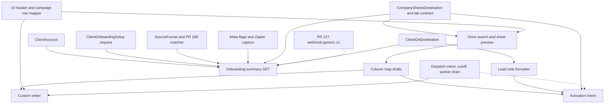

# Client onboarding v2 — Admin C.O.C. workspace contract

Design only. This document does not deploy, merge, toggle flags, change production
accounts, mutate lead data, resend webhooks, or write to Google or GoHighLevel.

Reviewed against `origin/master` `15cafc129c2768fc8034a0dcbcdc1ec137e77c69`
(Monday, October 26, 2026, 8:39 AM ET, the merge of PR #225) and open PR #227
at `f9c7e801db7e92a7b3d50369c9fd1c463614ff86`.

The workspace is one Admin C.O.C. surface per `ClientAccount`. It composes
sources of truth that already exist. It does not create a second client
registry, a second Sheets writer, a second routing matcher, or a second GHL
contact client.

`ClientOnboardingSetup` stays an administrative request. A setup choice is not
a connected sheet, a confirmed source, a GHL location, or a live switch.

## Matt's workflow, and the product boundary

| Observed step | What SA360 records | What this contract does not do |
| --- | --- | --- |
| Locate or duplicate a webform or funnel | Confirmed `SourceFunnel` for the published LeadCapture identity, or the existing Facebook page+form association | Duplicate a form inside LeadCapture or Meta |
| Configure a Zapier source and filters | The external Zap remains the delivery path until a native destination is armed | Disable, edit, or replace the Zap. No new filter engine |
| Inspect the client's existing spreadsheet | Drive search inside the approved parent or linked client folder, pasted-id resolution, tab preview | Fetch an arbitrary pasted URL. Create or rewrite tabs during preview |
| Format dates and map fields | Versioned map, or the v3 exact-header fast path | Calculate age from date of birth. Copy Primary Reason into Primary Concern |
| Connect LeadConnector and enroll an initial workflow | Existing `ClientGhlDestination`, or a disabled `webhook.generic.v1` target | Post a contact, note, tag, or webhook from onboarding save |
| Submit a test from the published form | Observation of the captured `SourceLeadEvent` | Re-POST the provider webhook |
| Inspect the GHL contact, its notes, and the spreadsheet | Separate receipts per destination | Treat one destination's success as the other's |

## Worked example: preexisting workbook

The acceptance fixture, not a production file, has four tabs:

| Tab | Rows | Onboarding classification | May be the campaign target in v2 |
| --- | --- | --- | --- |
| `VET Web Form` | 15-column legacy header, five historical lead rows | `legacy_custom_required` | Only after a published custom map and the custom writer. Appending never rewrites those rows or row 1 |
| `Daily Stats` | irrelevant | `stats_excluded` | No |
| `Weekly Stats` | irrelevant | `stats_excluded` | No |
| `Campaign Leads` | empty body; row 1 is the 35 `company_sheets_campaign_v3` headers in order | `v3_exact_header` | Yes, after the existing explicit bind. Fast path does not auto-save |

`company_sheets_campaign_v3` is 35 columns, counted from
`COMPANY_SHEETS_V3_HEADER` in `packages/shared/src/company-sheets-column-template.ts`.
Niche selection does not change that header. The safe path for this workbook is
to bind `Campaign Leads` through the existing campaign bind. `VET Web Form`
stays unbound until the custom-writer PR. Stats tabs are not selectable.

Header cells named below are the only legacy names this contract requires.
The other thirteen legacy headers are whatever the preview snapshot reads.
Do not invent them in code.

## Closed vocabulary

Agents implement these strings. Do not add a synonym for the same fact.

### Proof kinds

`linked`, `observed`, `routing_matched`, and `delivery` are four fields on
every source. One field does not imply the next.

| Kind | Satisfied when | Not satisfied by |
| --- | --- | --- |
| `linked` | `SourceFunnel.associationStatus` is `confirmed` and `originClientAccountId` is this client | A suggestion, a display name, a UTM value, a route key |
| `observed` | `firstSeenAt` is set, or a stored event identity-matches this funnel | A synthetic Sheets row, a column-mapping preview, the internal pilot lead |
| `routing_matched` | A stored event has status `routing_matched`, `clientAccountIdResolved` is this client, and authority is an exact `CampaignRoutingRule` or `confirmed_source_association` for this funnel | A loose UTM or keyword rule. Report that as `loose_rule_not_source_proof` |
| `delivery` | A post-cutoff Sheets job succeeded, or a post-cutoff GHL receipt succeeded, for that event | A permission probe, a pre-cutoff event, a Zapier write SA360 did not perform, an HTTP 2xx used as note proof |

Meta capture-only can be `linked` and `observed` with `routing_matched` false
and `delivery` false. That is complete for capture-only. It is not a routing
failure and it is not delivery proof.

### Sheet classifications

`v3_exact_header`, `v3_prefix_with_extra_columns`, `known_schema_exact`,
`compatible_empty`, `legacy_custom_required`, `stats_excluded`, `not_grid`,
`incompatible`.

### GHL modes

`unset`, `location_api`, `inbound_webhook`, `external_zapier`.

### Test-run kinds

`preview`, `captured_event_replay`, `synthetic_delivery`.

### Receipt kinds

`permission_probe`, `synthetic_row`, `captured_event`, `natural_event`.

### Destination ids

`google_sheets`, `ghl_location_api`, `ghl_inbound_webhook`.

## A. Summary and readiness

`GET /admin/v1/clients/:clientAccountId/onboarding`

Flag `SA360_CLIENT_ONBOARDING_V2_READ_ENABLED` must be exactly `true`. Otherwise
`404` with `error: "onboarding_read_disabled"`. The handler reads Postgres
only. It does not call Google, GHL, Meta, or LeadCapture.

`clientAccountId` matches `^[A-Za-z0-9][A-Za-z0-9_-]{0,127}$`. Unknown id is
`404` `client_not_found`.

```json
{
  "ok": true,
  "contractVersion": "client_onboarding_v2",
  "client": {
    "clientAccountId": "alex_gross",
    "clientDisplayName": "Alex Gross",
    "status": "onboarding",
    "primaryNicheKeys": ["vet"],
    "primaryProductTypes": []
  },
  "setupRequest": {
    "present": true,
    "status": "draft",
    "revision": 1,
    "destinationChoice": "both",
    "operational": false
  },
  "sources": [],
  "sheets": {
    "destinationSaved": false,
    "spreadsheetId": null,
    "campaignTab": null,
    "campaignDispatchEnabled": false,
    "campaignDispatchNotBefore": null,
    "agedDispatchEnabled": false,
    "writeReadiness": null,
    "deliveryExecution": null,
    "uncertainJob": false
  },
  "ghl": {
    "mode": "unset",
    "locationIdPresent": false,
    "workflowTriggerMode": null,
    "workflowIdPresent": false,
    "inboundWebhookArmed": false,
    "notesEnabled": false,
    "notesContractVersion": null
  },
  "externalZapier": {
    "preserved": true,
    "replacedByNative": false
  },
  "gates": [],
  "liveActivationPerformedByOnboarding": false,
  "blockers": []
}
```

`setupRequest` is the `ClientOnboardingSetup` projection. `operational` is
always `false`. `sources` is the source-proof array from section D, not a copy
stored on the setup document.

`sheets.campaignDispatchEnabled` and the cutoff are read from
`CompanySheetsDestination`. This GET does not change them. A pilot that is
already on stays on. Aged dispatch is reported and is not a campaign gate.

`gates[].id` is one of:

- `leadcapture_linked`
- `leadcapture_observed`
- `leadcapture_routing_matched`
- `meta_capture_only_acknowledged`
- `meta_linked`
- `meta_routing_matched`
- `sheets_destination_saved`
- `sheets_control_verified`
- `sheets_tab_explicitly_bound`
- `sheets_header_dispatch_ready`
- `sheets_custom_map_published`
- `sheets_permission_probe`
- `sheets_writer_receipt`
- `sheets_no_uncertain_job`
- `ghl_mode_explicit`
- `ghl_location_configured`
- `ghl_webhook_stored_disabled`
- `ghl_note_contract_ready`
- `zapier_not_disabled`
- `aged_not_activated_by_onboarding`

Each gate is `{ "id", "required", "satisfied", "evidenceIds": [] }`.
`required` depends on the selected modes. A client with no Meta source does
not require the Meta gates. A client whose GHL mode is `external_zapier` does
not require location or webhook gates. Sheets gates are required only when
the destination profile selects Sheets. Unselected destinations stay visible
and `required: false`.

`liveActivationPerformedByOnboarding` stays `false`. Arming campaign dispatch
remains `POST /admin/v1/clients/:clientAccountId/google-sheets/dispatch-activation`.
This workspace does not call it.

## B. Drive search, pasted folder, sheet selection

Pasted identifiers stay on the current routes. Those routes parse an id out of
a spreadsheet or folder URL and then call Drive. They do not HTTP-fetch the
pasted URL.

| Existing route | Role in v2 |
| --- | --- |
| `POST /admin/v1/clients/:clientAccountId/google-sheets/folder/resolve` | Resolve one pasted folder id or folder URL |
| `POST .../google-sheets/folder` | Create or link the display-name client folder. Unchanged claim behavior |
| `GET .../google-sheets/folder/spreadsheets` | List spreadsheets already under the linked client folder |
| `POST .../google-sheets/resolve` | Resolve one pasted spreadsheet id or URL |
| `POST .../google-sheets/create` | Create a spreadsheet in a verified folder |
| `PUT .../google-sheets/destination` | The only save. Search and preview do not save |
| `POST .../google-sheets/tabs/inspect` | Unchanged. Does not classify stats or legacy maps |
| `POST .../google-sheets/tabs/bind` | Unchanged v1/v2/v3 bind. Not used for a legacy header |

New reads use the existing setup flag `SA360_COMPANY_GOOGLE_SHEETS_ENABLED`.
They do not use the execution flag or the dispatch flag. They do not create
files, change parents, or call `permissions.create`.

### `POST /admin/v1/clients/:clientAccountId/onboarding/drive/search`

```json
{ "scope": "approved_parent", "query": "Alex", "pageToken": null }
```

`scope` is `approved_parent` or `client_folder`. `query` is 1–80 characters
after trim. The server builds the Drive query. The request is not Drive query
language. Search is the approved shared-drive parent, or the folder already
linked to this client. A shortcut is listed as `shortcut: true` and is not
followed. Trashed items are returned with `trashed: true` and
`selectable: false`.

```json
{
  "ok": true,
  "saved": false,
  "items": [
    {
      "id": "drive-file-id",
      "title": "Alex Gross",
      "mimeType": "application/vnd.google-apps.spreadsheet",
      "kind": "spreadsheet",
      "driveId": "approved-drive",
      "parents": ["approved-parent"],
      "trashed": false,
      "shortcut": false,
      "selectable": true
    }
  ],
  "nextPageToken": null
}
```

`saved` is always `false`. Selecting a hit is a later `PUT` to the existing
destination route, after resolve and control checks. A file that fails
`establishControl` is not selectable (`not_company_controlled`,
`unapproved_shared_drive`, `outside_approved_parent`, and the other current
control codes).

### `POST /admin/v1/clients/:clientAccountId/onboarding/sheets/preview`

```json
{ "spreadsheetId": "spreadsheet-id", "purpose": "campaign" }
```

`purpose` is `campaign` only in v2. Aged tabs stay on the export-package
header. The spreadsheet must pass `establishControl` for the company
connection. Preview reads worksheet metadata and `A1:ZZ2` plus the existing
column-A probe capped at `COMPANY_SHEETS_RECONCILE_ROW_CAP` (5000). It does
not call `values.update`, `values.append`, `spreadsheets.batchUpdate`, or
`permissions.create`.

```json
{
  "ok": true,
  "saved": false,
  "spreadsheetId": "spreadsheet-id",
  "spreadsheetTitle": "Alex Gross",
  "worksheets": [
    {
      "worksheetId": 0,
      "title": "Campaign Leads",
      "grid": true,
      "header": ["Date"],
      "headerColumnCount": 35,
      "historicalDataRows": "empty",
      "classification": "v3_exact_header",
      "fastPath": true,
      "deliveryEligible": true,
      "requiresExplicitSelection": true,
      "reasons": []
    }
  ]
}
```

`historicalDataRows` is `empty`, `has_rows`, or `truncated`. When the probe
reads every occupied column-A cell and the count of non-header rows is known,
also return `historicalDataRowCount`. Five legacy rows is `has_rows` with
count `5`. `truncated` is not a fast path and cannot be published as a map,
because the header check is incomplete (`reconcile_incomplete`).

Classification rules, applied in this order:

1. Title trimmed, case-insensitive, equal to `Daily Stats` or `Weekly Stats`
   → `stats_excluded`. `deliveryEligible: false`. `fastPath: false`. v2 has
   no override. `Weekly Statistics` is not this rule.
2. Not a grid → `not_grid`.
3. Header length is 35 and cell `i` equals `COMPANY_SHEETS_V3_HEADER[i]` with
   no trim and no case fold → `v3_exact_header`, `fastPath: true`. Empty body
   still matches. This is the Campaign Leads case.
4. Header is longer than 35 and the first 35 cells equal the v3 header →
   `v3_prefix_with_extra_columns`, `fastPath: false`. Tab inspect uses a
   prefix `sameHeader` and can classify that sheet as compatible. Dispatch
   readiness, campaign-test, and execute use exact length
   (`storedHeader.length === expectedHeader.length`, and `sameContractHeader`
   in the delivery service). Preview must not call a prefix match the fast
   path. Do not change either comparator in the onboarding PRs.
5. Header equals the v1 or v2 campaign header at exact length →
   `known_schema_exact`. Eligible for the existing bind. Not the v3 fast path.
6. Blank grid → `compatible_empty`. Eligible for the existing header
   provision. Not a legacy map.
7. Any other non-empty header, including a 15-column `VET Web Form` →
   `legacy_custom_required`, `fastPath: false`, `deliveryEligible: false`
   until a published map's header snapshot equals this header and the custom
   writer flag is on. Five historical rows do not block mapping. They block
   any rewrite.

`requiresExplicitSelection` is true whenever `deliveryEligible` is true.
Nothing in preview binds a tab or chooses a default worksheet. The first grid
is not a default. `VET Web Form` is not a default because it is a legacy
header. Stats tabs are excluded before eligibility.

API defaults agents must not "align":

- Tab bind omits `schemaVersion` → `company_sheets_campaign_v1`.
- `POST .../google-sheets/column-mapping` omits `schemaVersion` →
  `company_sheets_campaign_v3`.
- The admin panel state defaults to v3 and sends that value on bind and create.

Onboarding calls always send an explicit schema version. They do not depend
on either default.

## C. Versioned column map

A map is delivery projection for one client, one source scope, and one
worksheet. It is not an intake alias. Do not add headers to
`DEFAULT_SOURCE_FIELD_ALIASES`.

`reviewCompanySheetsColumnMapping` stays the v1/v2/v3 template review. It
keeps returning `customMapping: false`. Custom assignments are not posted to
that route.

### Identity

Unique published row: `(clientAccountId, sourceScope, spreadsheetId, worksheetId)`
where `sourceScope` is `shared`, or `funnel:{sourceFunnelId}`.

Writer precedence:

1. Published map whose `sourceFunnelId` is the event's matched funnel.
2. Published `shared` map for that spreadsheet and worksheet.
3. Bound schema `company_sheets_campaign_v3` (or v1/v2) with no custom map:
   the existing campaign row mapper.
4. Otherwise fail closed `mapping_required`. Do not append.

A draft is never used by the writer. Publishing a replacement requires the
previous published row to be `retired` first. `mapVersion` increments on that
scope and is copied onto the delivery job. A later edit does not change a job
already enqueued. The idempotency keys stay the current ones, so a new map
version does not deliver the same event again:

- Intent: `campaign:{clientAccountId}:{sourceLeadEventId}`
- Job: `lead:{clientAccountId}:{sourceLeadEventId}`

### Assignment

```json
{
  "sheetHeader": "Primary Reason",
  "target": { "kind": "v3_column", "header": "Primary Reason", "sourceField": "primary_reason" },
  "transform": "passthrough",
  "decision": "mapped",
  "explicit": true
}
```

`decision` is `mapped`, `unmapped`, or `ambiguous`. `transform` is
`passthrough`, `trim`, `date_america_new_york`, or `blank`.

`target.header` is one of the 35 v3 headers. `target.sourceField` is that
column's `sourceField`. The pair is checked against
`COMPANY_SHEETS_V3_COLUMNS`. A mismatched pair is `422` `unknown_target`.

Legacy output shape: the writer emits cells in `headerSnapshot` order. It does
not insert `delivery_row_id`, `client_account_id`, `source_lead_event_id`, or
`received_at` into a legacy header. Those identities stay on the job and row
tables. Schema version for that job is `company_sheets_campaign_custom_v1`.

Until the custom-writer PR, publish may store the map and must not write
`company_sheets_campaign_custom_v1` onto `CompanySheetsTabContract`. Today's
`companySheetsCampaignHeader` returns null for an unknown version, and bind
rejects it. Leaving the tab schema alone keeps dispatch fail-closed.

### Forbidden and ambiguous mappings

Normalize only for these rules: trim, lowercase, collapse whitespace, remove
whitespace around `/`.

| Normalized header | Rule |
| --- | --- |
| `age/dob` | `ambiguous`, code `ambiguous_age_or_dob`. Covers `Age/ DOB`, `Age/DOB`, and `Age / DOB`. Plain `Age` and plain `DOB` are not this rule |
| `primary reason` | May target only v3 `Primary Reason` / `primary_reason`. Targeting `Primary Concern` / `primary_concern` is `422` `primary_reason_is_not_primary_concern`. v2 has no override phrase |
| `primary concern` | May target only `Primary Concern` / `primary_concern` |

`Age/ DOB` cannot be published while `ambiguous`. The operator submits one
explicit decision:

- target `Age`, transform `passthrough` (an age; not parsed as a date)
- target `DOB`, transform `date_america_new_york` (a date; age is not calculated)
- `decision: "unmapped"`, transform `blank`

v3 fast path does not use this normalizer. `Age` and `DOB` are already
separate columns. The campaign mapper reads stored `consumer_age` and stored
`date_of_birth`. It does not derive one from the other. Primary Reason and
Primary Concern stay separate columns. That behavior is already in
`company-sheets-campaign-row.ts` and the alias registry. Custom maps must not
weaken it.

### Dates

`date_america_new_york` writes a date-only value as `MM/DD/YYYY` without
moving the calendar day. A timestamp with an offset is converted to
`America/New_York` and then formatted `MM/DD/YYYY`. A missing value stays
blank. Delivery time is not substituted. The v3 `Date` column remains the
generation timestamp from the existing mapper, not this legacy transform.

### Routes

Flag `SA360_CLIENT_ONBOARDING_V2_CONFIG_ENABLED` must be exactly `true`.
Otherwise `404` `onboarding_config_disabled`.

| Method and path | Effect |
| --- | --- |
| `GET /admin/v1/clients/:clientAccountId/onboarding/column-maps` | List drafts and published maps for this client. Query `worksheetId` optional |
| `POST .../onboarding/column-maps` | Create a draft from a preview header snapshot taken in this request. Does not trust a client-supplied header without re-reading the sheet |
| `PATCH .../onboarding/column-maps/:mapId` | Replace assignments. Body includes `expectedRevision` |
| `POST .../onboarding/column-maps/:mapId/publish` | Publish when every column is explicit and none are `ambiguous`, and the live header still equals the snapshot |
| `POST .../onboarding/column-maps/:mapId/retire` | Retire. Does not delete. Does not rewrite sheet cells |

Create body:

```json
{
  "requestId": "uuid",
  "spreadsheetId": "id",
  "worksheetId": 0,
  "sourceScope": "shared",
  "baseSchemaVersion": "legacy_custom"
}
```

`baseSchemaVersion` `company_sheets_campaign_v3` is rejected with
`use_existing_v3_bind` when preview is `v3_exact_header`. The fast path has
no custom map. `sourceScope` `funnel:{id}` requires that funnel's confirmed
origin to be this client.

Stale `expectedRevision` is `409` `revision_conflict`. Header drift since the
snapshot is `409` `header_changed`. Publish of an unresolved age column is
`422` `mapping_unresolved`.

### Persistence

Auth/Account migration only. Additive tables:

`ClientSheetColumnMap`

- `id`, `clientAccountId` (cascade with the account)
- `sourceScope` string
- `spreadsheetId`, `worksheetId` int
- `mapVersion` int
- `status` `draft | published | retired`
- `baseSchemaVersion` string
- `headerSnapshot` Json string array
- `assignments` Json
- `revision` int
- `publishedAt`, `retiredAt`, `createdAt`, `updatedAt`
- partial unique index: one `published` row per client, source scope, spreadsheet, worksheet

`ClientOnboardingV2AuditEvent`

- append-only, `requestId` unique
- `historicalClientAccountId` retained if the account is rekeyed or deleted
- `actorLabel` from `x-sa360-admin-actor`, stored as an untrusted label
- `auth` always `admin_api_key` until staff identities exist

No backfill. No change to `CompanySheetsDestination`, `CompanySheetsTabContract`,
intake tables, inventory, orders, or pricing.

## D. Source proof

`GET /admin/v1/clients/:clientAccountId/onboarding/source-proof`

Same read flag as the summary. No webhook resend. No call to
`pnpm source-intake:one-event-reconcile`. No routing recompute.

```json
{
  "ok": true,
  "sources": [
    {
      "sourceKind": "leadcapture",
      "sourceFunnelId": "funnel_id",
      "associationStatus": "confirmed",
      "identity": {
        "provider": "leadcapture_io",
        "providerFunnelId": null,
        "parentUrlKey": "go.example.com/alex",
        "pageSlug": null
      },
      "proofs": {
        "linked": { "satisfied": true, "at": "2026-10-26T14:00:00.000Z" },
        "observed": {
          "satisfied": false,
          "at": null,
          "sourceLeadEventId": null,
          "intakeStage": null,
          "captureOnly": false
        },
        "routingMatched": {
          "satisfied": false,
          "authority": null,
          "routingDryRunDecisionId": null,
          "matchedRuleId": null,
          "looseRuleIgnored": null
        },
        "delivery": {
          "satisfied": false,
          "sheetsJobId": null,
          "ghlReceiptId": null
        }
      }
    }
  ]
}
```

`sourceKind` is `leadcapture`, `meta_lead_ads`, or `zapier_facebook`.

LeadCapture identity is the existing matcher: provider form id, then
`parentUrlKey`, then a single hosted slug on `my.leadcapture.io`. Route keys
are not a lookup. This GET does not import a second matcher. It reads
`SourceFunnel` and stored `routingResultJson.sourceAssociation`.

Meta direct intake and Zapier capture stay distinct:

| Path | Flags today | What proof it can produce |
| --- | --- | --- |
| Meta notification retained | `SA360_META_LEAD_ADS_INTAKE_ENABLED` | Not observed contact fields unless fetch ran |
| Meta Graph field fetch, routing off | intake on, `SA360_META_LEAD_ADS_ROUTING_ENABLED` off. `captureMode = !routingEnabled` in `meta-leadgen-fetch.service.ts` | `observed`, `captureOnly: true`. Routing and delivery stay false. `FACEBOOK_DIRECT_INTAKE_ENABLED` is the legacy alias that turns intake, Graph fetch, and routing all on. v2 does not turn that alias on |
| Meta routing on | `SA360_META_LEAD_ADS_ROUTING_ENABLED` | Can satisfy `routing_matched` through the same dry-run as LeadCapture. Still not delivery |
| Zapier Facebook capture | `SA360_FACEBOOK_CAPTURE_INTAKE_ENABLED` | `observed` only. `delivery.thisRequestAttempted` is false (`capture_only_intake_does_not_deliver`). Association is `fbpage:{pageId}:fbform:{formId}` on `SourceFunnel` |
| Confirmed LeadCapture association | none of the delivery flags | `routing_matched` when no exact rule won. PR #168. Delivery stays off |

`delivery.satisfied` for Sheets requires a `CompanySheetsDeliveryJob` with
`kind: "lead"`, `status: "succeeded"`, this client, and this
`sourceLeadEventId`, whose intent was created at or after
`campaignDispatchNotBefore`. A canary job, a campaign-test synthetic row, and
`spreadsheetDeliveredAt` do not count.

`delivery.satisfied` for GHL is section E. Webhook HTTP 2xx and a location-API
note are different receipt ids. Neither satisfies Sheets.

## E. GHL destination and notes

Two implementations exist. Onboarding must name which one a client uses.

| Mode | Source of truth | What it does today | Note proof |
| --- | --- | --- | --- |
| `location_api` | `ClientGhlDestination` | Contact upsert, custom fields, tags, optional opportunity, workflow via `workflowTriggerMode` (`none`, `direct_api`, `tag_trigger`). Default remains `tag_trigger`. Direct API is `POST /contacts/:contactId/workflow/:workflowId` only when `destinationWorkflowIdGhl` is set | SA360 can post one note after the contact id is known |
| `inbound_webhook` | `DeliveryTarget` `adapterKey: "webhook.generic.v1"` | Not on master. PR #227 posts JSON after routing commit when the global flag, `enabled`, `campaignDispatchEnabled`, and `campaignDispatchNotBefore` are all set | HTTP 2xx is not a note. `workflowIdKnown: false` |
| `external_zapier` | none in SA360 | The Zap keeps delivering | SA360 has no receipt |

`tag_trigger` adds `SA360::TRIGGER::NEW_LEAD` and does not call the workflow
API. A receipt for that mode says `workflowApiCalled: false` and
`triggerTagPlanned: true`. It does not claim the workflow ran.

Location id, workflow id, assigned user, and trigger mode stay on
`ClientGhlDestination` and the existing `PATCH /admin/v1/clients/:clientAccountId/ghl-destination`.
Do not copy them onto a second column. Config discovery stays
`POST /admin/v1/clients/:clientAccountId/ghl-config`.

### Profile

`GET` and `PUT /admin/v1/clients/:clientAccountId/onboarding/destinations`

PUT body:

```json
{
  "requestId": "uuid",
  "expectedRevision": 0,
  "sheetsSelected": true,
  "ghlMode": "location_api",
  "notesEnabled": false
}
```

PUT does not set `deliveryEnabled`, `clientCutoverApproved`,
`campaignDispatchEnabled`, `agedDispatchEnabled`, target `enabled`, or any
cutoff. `notesEnabled: true` requires `ghlMode: "location_api"` and stores
`notesContractVersion: "sa360_lead_note_v1"`. Other modes force
`notesEnabled: false`.

### Disabled webhook target

`PUT /admin/v1/clients/:clientAccountId/onboarding/ghl-webhook-target`

```json
{
  "requestId": "uuid",
  "endpointUrl": "https://services.leadconnectorhq.com/hooks/example"
}
```

The URL must be `https`, with no username, password, or embedded credentials.
The row is created or updated only in this shape:

- `adapterKey`: `webhook.generic.v1`
- `enabled`: false
- `isPrimary`: false
- `isRequired`: false
- `configMetadataJson.endpointUrl`: the URL
- `configMetadataJson.campaignDispatchEnabled`: false
- `configMetadataJson.campaignDispatchNotBefore`: null

`listEnabledDeliveryTargetsForClient` ignores a disabled row, so LF2 planning
does not gain an instruction. If an enabled `webhook.generic.v1` row already
exists for this client, the PUT returns `409` `webhook_target_already_armed`
and does not change it. The response redacts the URL in logs. The admin JSON
may return the URL to an ADMIN session only.

This shape is what PR #227 refuses to send (`not_armed`). Saving it cannot
become live delivery when `SA360_GHL_INBOUND_WEBHOOK_ENABLED` is later turned
on. Arming is a separate, unauthorized route that this design does not add.

### Note body

Pure function `buildOnboardingLeadNote` in the GHL delivery adapter package.
Do not reuse the Agent Workspace outcome note in `ghl-sync.service.ts`.

Title: `SA360 lead`

Lines, stable order, omit a line only when the instruction says the value is
absent. Use `not supplied` for an empty lead field. Never dump the raw payload.

```text
Lead: Ada Lovelace
Phone: +15550100
Email: ada@example.com
State: TX
Date: 10/26/2026
Lead type: VET
Age: 47
DOB: 04/12/1979
Primary reason: Family
Primary concern: not supplied
Source: leadcapture go.example.com/alex
SA360 event: event_id
```

`Primary reason` reads `primary_reason` only. `Primary concern` reads
`primary_concern` only. `Age` and `DOB` are separate lines. The label
`Age/ DOB` is not used. Date of birth formatting follows
`date_america_new_york`. Generation `Date` follows the v3 rule: blank source
timestamp becomes `not supplied`, not the delivery clock.

The note POST runs only when all of these are true: mode is `location_api`,
`notesEnabled` is true, this delivery already has a GHL contact id, and the
execution path is the existing GHL adapter rather than onboarding save.
Idempotency key `ghl-note:{clientAccountId}:{sourceLeadEventId}`. A second
source event for the same person is a second note. A retry of the same event
is not a second note. Timeout and HTTP 5xx stay unknown and are not posted
again. That matches the write-retry policy PR #227 proposes for
`ghl-live-transport.ts`. Do not edit that file in the onboarding PRs. Do not
store the note on `GhlLiveDeliveryRun` under mode `ghl_inbound_webhook`.

Inbound-webhook mode does not post this note from SA360. A later read-only
probe may record `ghl_note_observed`. That probe is not part of v2 and is not
implied by webhook 2xx.

PR #227's payload, if merged, remains exactly:

```json
{
  "sourceLeadEventId": "event_id",
  "clientAccountId": "client_id",
  "receivedAt": "2026-10-26T18:00:00.000Z",
  "campaignId": null,
  "contact": { "firstName": null, "lastName": null, "email": null, "phone": null }
}
```

Onboarding must not add note lines, age, or primary reason to that body.
Contact email and phone stay out of the webhook idempotency key
`ghl-webhook:{clientAccountId}:{sourceLeadEventId}`.

## F. Test runs

`POST /admin/v1/clients/:clientAccountId/onboarding/test-runs`

```json
{
  "requestId": "uuid",
  "kind": "preview",
  "destination": "google_sheets",
  "sourceLeadEventId": null,
  "execute": false
}
```

`destination` is `google_sheets`, `ghl_location_api`, `ghl_inbound_webhook`,
or `both`. `both` still returns two independent previews.

| Kind | `execute` | External calls | Proves |
| --- | --- | --- | --- |
| `preview` | must be false | none | The row text or note text that would be sent |
| `captured_event_replay` | must be false | none. Does not re-POST the provider | The stored event maps through the published map or v3 mapper. Not delivery |
| `synthetic_delivery` | true only for Sheets, and only by calling the existing campaign-test route | one Sheets append when that route already allows it | A synthetic row. Not a source event, not inventory, not billing, not a dispatch intent |

`captured_event_replay` loads `SourceLeadEvent` and requires
`clientAccountIdResolved === path client`. Otherwise `403` `tenant_mismatch`.
An unresolved event is `409` `event_not_client_owned`. Events with
`recordClass` `company_sheets_internal_pilot` or route
`company_sheets_internal_pilot` are `409` `internal_pilot_not_client_proof`
when the path client is not `company_sheets_internal_test`.

Sheets `synthetic_delivery` does not grow a second writer. The handler records
a test-run row and delegates to the existing
`POST /admin/v1/clients/:clientAccountId/google-sheets/campaign-test`.
An uncertain prior append is not retried. GHL `synthetic_delivery` is rejected
with `ghl_synthetic_disabled` unless
`SA360_CLIENT_ONBOARDING_GHL_SYNTHETIC_ENABLED` is exactly `true`. That flag
stays off. This design does not authorize turning it on. No production test
event is created.

`GET .../onboarding/test-runs/:testRunId` returns the stored preview and
`externalCalls: { "sheets": false, "ghl": false, "providerWebhook": false }`
for the two non-executing kinds.

Persistence: `ClientOnboardingTestRun` (`id`, `clientAccountId`, `kind`,
`destination`, `sourceLeadEventId` nullable, `mapId` nullable, `mapVersion`
nullable, `requestId` unique, `status` `previewed | executed | uncertain | failed`,
`previewJson`, `createdAt`). Cascade with the client. Do not delete runs to
hide a failed or uncertain result.

## G. Receipts and activation gates

`GET /admin/v1/clients/:clientAccountId/onboarding/receipts`

A receipt is one destination and one proof kind. Sheets success does not
satisfy GHL. GHL success does not satisfy Sheets. A permission probe does not
satisfy a writer receipt.

```json
{
  "ok": true,
  "receipts": [
    {
      "id": "receipt_id",
      "destination": "google_sheets",
      "kind": "permission_probe",
      "proves": ["company_account_can_edit"],
      "doesNotProve": ["row_appended", "campaign_dispatch", "source_delivery", "ghl"],
      "rowWritten": false,
      "sourceLeadEventId": null,
      "spreadsheetId": "id",
      "worksheetId": 0,
      "jobId": null,
      "occurredAt": "2026-10-26T18:00:00.000Z"
    }
  ]
}
```

The existing write probe (`rowWritten: false`, `campaignDeliveryVerified: false`)
maps to `permission_probe`. Send Test Row maps to `synthetic_row` and names
the saved spreadsheet and tab. A succeeded lead job for a real event maps to
`natural_event` only when the event was not created by campaign-test or the
internal pilot.

`POST /admin/v1/clients/:clientAccountId/onboarding/activation-intent`

```json
{
  "requestId": "uuid",
  "destination": "google_sheets_campaign",
  "confirmation": "ACTIVATE CLIENT ONBOARDING DESTINATION",
  "expectedReceiptIds": ["receipt_id"]
}
```

The confirmation phrase is required. The handler re-evaluates gates. It writes
`ClientOnboardingActivationIntent` with status `ready_for_operator` or
`blocked`. It does not set a cutoff, does not call
`setCompanySheetsDispatchActivation`, and does not enable global flags.

Sheets intent is `ready_for_operator` only when:

- the company Google connection is `connected`
- the destination is saved for this client and `establishControl` still passes
- the campaign tab is bound
- the bound header is exact-length v3, or a published custom map matches and
  `SA360_CLIENT_ONBOARDING_V2_CUSTOM_WRITER_ENABLED` is exactly `true`
- the bound worksheet is not classified `stats_excluded`
- a `permission_probe` receipt exists for this spreadsheet and worksheet after
  the latest bind
- a `synthetic_row` or client-owned `captured_event` Sheets receipt succeeded
  for that tab
- no job for that worksheet is `uncertain`
- aged dispatch is unchanged
- the request does not ask to move `campaignDispatchNotBefore`

GHL intent is `ready_for_operator` only when the mode is explicit, a location
mode has a location id and a workflow mode, a webhook mode has a disabled
target only, and notes-enabled mode has a stored preview of
`sa360_lead_note_v1`. There is no waiver field. `activationWithoutLiveReceipt`
is not accepted.

Natural end-to-end delivery stays a separate gate from test receipts. The
Monday pilot runbook's fifth state (a real post-cutoff lead on the tab) is
`natural_event`. An intent does not mark that state done.

Existing arming, unchanged and outside this workspace:

- `POST .../google-sheets/dispatch-activation` sets the client switch and, only
  when the cutoff is null, sets `campaignDispatchNotBefore` to now. It never
  moves an existing cutoff earlier. Disabling the switch does not clear the
  cutoff and does not delete intents.
- Do not copy `2026-10-22T00:50:17.124Z`.
- Global `SA360_COMPANY_GOOGLE_SHEETS_DISPATCH_ENABLED` and
  `SA360_COMPANY_GOOGLE_SHEETS_EXECUTION_ENABLED` default off. Off inserts no
  intents and does not scan history. The worker posts to
  `/admin/v1/company-sheets/internal/process-dispatch` and does not call Google.

## H. Staff authorization and tenant isolation

| Caller | Onboarding routes |
| --- | --- |
| Admin C.O.C. session role `ADMIN`, and `x-sa360-admin-key` | Allowed when the flag for that route is on |
| Session role `SA360_OBSERVER` | Denied, including GET. Do not add these paths to the observer allowlist. Payloads contain contact fields and can contain a webhook URL |
| Anonymous | 401 |
| Portal session, `x-sa360-client-portal-key`, workspace key | 403. A body or query `clientAccountId` on a portal route remains illegal |
| Public webhooks | No new routes |

The path client is the tenant. A body `clientAccountId` that differs from the
path is `400` `client_account_mismatch`. Maps, runs, receipts, and intents are
queried with that path id. List endpoints do not return another client's rows.

Replay and delivery reads require the event's resolved client to equal the
path. Preview of a spreadsheet requires company control, not merely that the
token can read a file.

`x-sa360-admin-actor` is stored as `actorLabel` and is not an authorization
decision. There is no per-staff user id on the `ac1` cookie. Staff identities,
invitations, and session revocation are Stage 2 of
`docs/roadmaps/native-client-onboarding.md`. v2 does not add a user table and
does not treat portal logins as staff.

Google Drive OAuth is not Google sign-in. The company connection stays the
single company row. It is not written onto `GoogleAccountConnection`.

## I. Current behavior and proposed behavior

| Fact | Current master | Proposed, after the PR sequence |
| --- | --- | --- |
| Client registry | `ClientAccount` | Unchanged |
| Setup form | `ClientOnboardingSetup` behind `SA360_NATIVE_CLIENT_SETUP_ENABLED`. Not operational | Still not operational. Summary links it and marks `operational: false` |
| LeadCapture routing | Exact rule, then confirmed association, then loose rule. PR #168 | Read-only proof. No new rules created during onboarding |
| Meta | Intake, Graph fetch, and routing are separate flags. Routing off settles capture-only | Proof distinguishes capture-only from routing-enabled. Flags stay as they are |
| Zapier Facebook | Capture-only. Does not deliver | Preserved. Mode `external_zapier` records that choice |
| Sheets fast path | Bind can prefix-match. Dispatch requires exact header length. UI defaults to v3 | Preview fast path is exact length 35. Legacy 15-column tabs are custom maps |
| Custom map | `customMapping: false` always | New table. v3 exact header does not create one |
| `Age/ DOB` | Not an alias of `age` or `date_of_birth` | Stays unmapped until an explicit Age, DOB, or blank decision |
| Primary Reason | Not copied into Primary Concern by the v3 mapper or the alias registry | Server rejects a custom assignment that would do that |
| Stats tabs | Bindable if a header happens to match a known schema | Title rule rejects `Daily Stats` and `Weekly Stats` in the workspace preview. Existing bind is unchanged until a later explicit change |
| GHL workflow | Location API, default `tag_trigger` | Same default. Inbound webhook is a different mode and is not armed here |
| GHL notes | Outcome sync notes only | New `sa360_lead_note_v1` body, location API only, one note per event |
| PR #227 | Open, not merged. Hook is after the Sheets intent transaction | Onboarding does not edit that hook. Disabled target cannot satisfy `not_armed` |
| Test row | `campaign-test` appends one synthetic row and does not flip dispatch | Reused. Not source proof |
| Activation | Client switch and global flags are separate | Intent checklist only. No new cutoff writer |
| Observer | `/clients` already denied | New routes stay off the allowlist |
| Portal | Reads company Sheets status. Cannot pass a client id | No onboarding routes |

## Flags

All new flags default unset. Only the exact string `true` enables them.
Enabling a flag is a separate authorization. This design does not turn any
flag on.

| Flag | When true |
| --- | --- |
| `SA360_CLIENT_ONBOARDING_V2_READ_ENABLED` | Summary and source-proof GET |
| `SA360_CLIENT_ONBOARDING_V2_CONFIG_ENABLED` | Map drafts, destination profile, disabled webhook PUT, test-run records, activation intent |
| `SA360_CLIENT_ONBOARDING_V2_CUSTOM_WRITER_ENABLED` | Append path for `company_sheets_campaign_custom_v1` only |
| `SA360_CLIENT_ONBOARDING_GHL_SYNTHETIC_ENABLED` | Reserved. Stays off. No implementation in the first GHL PR |

Unchanged, and not switched by these PRs: `SA360_COMPANY_GOOGLE_OAUTH_ENABLED`,
`SA360_COMPANY_GOOGLE_SHEETS_ENABLED`, `SA360_COMPANY_GOOGLE_SHEETS_EXECUTION_ENABLED`,
`SA360_COMPANY_GOOGLE_SHEETS_DISPATCH_ENABLED`, `SA360_GOOGLE_OAUTH_ENABLED`,
`SA360_GOOGLE_SHEETS_DESTINATION_ENABLED`, `SA360_NATIVE_CLIENT_SETUP_ENABLED`,
`SA360_META_LEAD_ADS_INTAKE_ENABLED`, `SA360_META_LEAD_ADS_GRAPH_FETCH_ENABLED`,
`SA360_META_LEAD_ADS_ROUTING_ENABLED`, `SA360_META_LEAD_ADS_FIXTURE_ENABLED`,
`FACEBOOK_DIRECT_INTAKE_ENABLED`, `SA360_FACEBOOK_CAPTURE_INTAKE_ENABLED`.
`SA360_GHL_INBOUND_WEBHOOK_ENABLED` exists only if PR #227 merges. Leave it off.

## Error codes

Closed set for the new routes. HTTP status is 400 for a malformed body, 401
for a missing admin key, 403 for observer, portal, or tenant mismatch, 404 for
a missing client or a disabled flag, 409 for a conflict, 422 for a mapping
rule.

`onboarding_read_disabled`, `onboarding_config_disabled`, `client_not_found`,
`client_account_mismatch`, `tenant_mismatch`, `revision_conflict`,
`header_changed`, `mapping_unresolved`, `mapping_required`,
`ambiguous_age_or_dob`, `primary_reason_is_not_primary_concern`,
`unknown_target`, `use_existing_v3_bind`, `stats_tab_not_a_delivery_target`,
`webhook_target_already_armed`, `invalid_endpoint`, `event_not_client_owned`,
`internal_pilot_not_client_proof`, `ghl_synthetic_disabled`,
`custom_writer_disabled`, `reconcile_incomplete`, plus the existing
`establishControl` codes when a Drive read fails.

## Dependency graph



Solid arrows are read or reuse. The dashed PR #227 arrow is a read after that
PR merges. The dashed dispatch arrow is "do not call". The custom writer is
the only new append path, and only for the custom schema version.

## File ownership

New onboarding files are the only shared edit surface. Existing files stay
with their current owners. One PR may add the route plugin registration in
`apps/api/src/app.ts`. Later PRs add routes inside the plugin file and do not
edit `app.ts` again.

| PR | May create or edit | Must not edit |
| --- | --- | --- |
| Docs (this change) | `docs/architecture/client-onboarding-v2.md`, `docs/operations/client-onboarding-v2-acceptance.md` | Application code, Prisma, flags |
| Auth migration | `prisma/schema.prisma` and one new migration for the tables in this document | Intake, inventory, orders, pricing, `DeliveryTarget` columns, `ClientGhlDestination` columns |
| Read API | `apps/api/src/services/client-onboarding-v2/readiness.ts`, `source-proof.ts`, `apps/api/src/schemas/client-onboarding-v2.schema.ts`, `apps/api/src/routes/admin-client-onboarding-v2.ts`, their tests, one `app.ts` registration | `source-intake-routing-persist.ts`, dispatch record, dedupe, inventory |
| Sheet preview | `apps/api/src/services/client-onboarding-v2/sheet-preview.ts` and its route in the plugin | `company-sheets-tab-contract.service.ts`, `sameHeader`, `reviewCompanySheetsColumnMapping` |
| Map config | `apps/api/src/services/client-onboarding-v2/column-maps.ts`, repository, tests | Alias registry, campaign row mapper, buyer CSV |
| Custom writer | `apps/api/src/services/company-sheets-delivery/company-sheets-custom-row.ts` and a single branch in the existing execute path that runs only for `company_sheets_campaign_custom_v1` when the writer flag is on | v1/v2/v3 row bytes, worker Google calls, worksheet lock rules |
| GHL profile and note | `apps/api/src/services/ghl-delivery-adapter/onboarding-lead-note.ts`, destination profile service | `ghl-live-transport.ts`, `ghl-inbound-workflow-delivery.ts`, `source-intake-routing-persist.ts` |
| Admin UI | `apps/admin-coc/src/app/(dashboard)/clients/[clientAccountId]/onboarding/**`, `apps/admin-coc/src/components/clients/onboarding/**` | `src/app/portal/**`, `company-sheets-admin-panel.tsx`, `nav.ts` and `sidebar-nav.tsx` until PR #207 has merged |
| Arming | None in this sequence | `setCompanySheetsDispatchActivation`, global flag defaults, Zapier configuration |

The custom-writer PR is the one exception that touches an existing execute
function. That edit is a guarded branch on schema version. It does not change
the v3 mapper, the intent key, the job key, the lock, or the uncertain-append
rule.

## PR sequence and blockers

1. **This design PR.** Docs only. Blocker for implementation: review against
   this contract so later agents do not invent routes.
2. **Auth/Account migration.** Blocker for every write. Additive tables only.
   Apply locally to `127.0.0.1` `sa360` and `sa360_test`. Do not apply to
   production from that PR.
3. **Read API.** Summary and source proof. Can start after the migration only
   if it needs no new columns. It can ship before the migration when it reads
   current tables only. Prefer that split so the GET is not blocked on schema.
4. **Sheet preview.** After the read plugin exists. Uses the current Sheets
   setup flag. No new schema.
5. **Map drafts and disabled destination profile.** Blocked on the migration
   and on preview's header snapshot.
6. **Custom writer.** Blocked on published maps. Legacy `VET Web Form` cannot
   be activated before this. v3 `Campaign Leads` does not wait for it.
7. **GHL note formatter and profile.** Blocked on the migration for the profile
   row. The pure note function can be unit-tested earlier and must not POST.
   Blocked on a PR #227 decision before any webhook arming. Compatible disabled
   target storage may land before #227 merges because master does not read
   `campaignDispatchEnabled` on `DeliveryTarget`.
8. **Admin workspace UI.** Blocked on the read API. Sidebar entry blocked on
   PR #207, or omitted until that PR merges. Observer allowlist is not updated.
9. **Arming PR.** Not scheduled. Requires a separate authorization, succeeded
   receipts, and no uncertain worksheet. It calls the existing dispatch
   activation route. It does not add a cutoff writer.

Blockers that stop the whole native cutover, not just one PR:

- PR #227 is open and unreviewed. Do not edit its five files. Do not treat its
  payload as the note contract. Do not enable `SA360_GHL_INBOUND_WEBHOOK_ENABLED`.
- Staff identity Stage 2 is not built. Authorization stays the admin API key
  plus the ADMIN cookie.
- Production Google and GHL writes, flag changes, and live activation are out
  of scope until a named authorization. The Monday Sheets runbook still governs
  any real client activation.
- Zapier deliveries stay in place. Native gates default off.
- Intake dedupe, inventory, pricing, order release, and the customer portal
  are out of scope. If a task needs those files, stop and record the dependency.

## Conflicts with open PRs

### PR #227 — Post each matched lead to a GHL inbound webhook

Draft, open. Branch `cursor/ghl-inbound-webhook-delivery-cbb5`, tip
`f9c7e801db7e92a7b3d50369c9fd1c463614ff86`. Files:

- `apps/api/src/services/ghl-outbound/ghl-inbound-workflow-delivery.ts`
- `apps/api/src/services/ghl-outbound/ghl-inbound-workflow-delivery.test.ts`
- `apps/api/src/services/source-intake/source-intake-routing-persist.ts`
- `apps/api/src/services/ghl-delivery-adapter/ghl-live-transport.ts`
- `apps/api/src/services/ghl-delivery-adapter/ghl-live-transport-retry.test.ts`

Conflicts:

- It calls `deliverGhlInboundWebhookFromIntake` after the lead transaction and
  after `recordCompanySheetsCampaignIntent`. A second onboarding call in that
  function will conflict and can double-post. No onboarding PR edits that file
  while #227 is open.
- Its payload has no notes, age, date of birth, or primary reason. Delivery
  proof from a 2xx is webhook acceptance only.
- It sends only when the target is enabled, `campaignDispatchEnabled` is true,
  and a cutoff is set. The onboarding PUT stores the opposite. An implementation
  that sets `enabled: true` while saving a URL becomes live the moment the
  flag is on. That is forbidden.
- It reuses `GhlLiveDeliveryRun` with mode `ghl_inbound_webhook` and key
  `ghl-webhook:{client}:{event}`. Notes must not reuse that mode or key.
- It changes write retries in `ghl-live-transport.ts`. Onboarding notes should
  follow that policy after merge, without editing the file in parallel.
- It does not add an admin save screen. The disabled PUT in this contract is
  the save it lacks. Arming remains unbuilt on purpose.
- Sheets intent behavior is explicitly left independent. A webhook failure must
  not roll back the lead or the Sheets intent. Onboarding receipts stay
  independent in the same way.

### Other open PRs

| PR | Overlap | Required behavior |
| --- | --- | --- |
| #207 sidebar groups | `nav.ts`, `sidebar-nav.tsx`, `page-meta.ts` | UI PR does not edit these until #207 merges. Ship the page without a nav change if needed |
| #201 portal Sheets card | `portal-company-sheets-card.tsx`, stacked on a pre-master branch | Do not edit. Portal card is not the onboarding workspace |
| #140 onboarding SOP | `docs/sop/client-onboarding-and-account-setup.md` | No file overlap. The SOP remains the manual procedure. This contract does not replace it |
| #141 Meta design doc | `docs/architecture/meta-lead-ads-direct-intake-phase-1.md` | Unmerged design. Cite master flags, not that document, as current behavior |
| #145 client Google Sheets design | superseded by the company-delivery doc and #225 | Do not follow it. No file overlap with these docs |
| #226, #221, #199, #188, #187 | historical catalog, roles, provenance, buyer CSV | Do not edit. The buyer-CSV rule that Primary Reason is not Primary Concern stays in that lane |
| #158 | portal inventory map | Do not edit portal order pages |
| #134, #104, #103, #102, #101, #186, #181, #180, #176, #175, #174, #10 | import adapter, validation, environment, backlog | No onboarding file overlap |

PR #225 is merged and is the Sheets base this contract extends. PR #168 is
merged and is the LeadCapture association reader this contract uses.

## Out of scope

Intake dedupe, inventory eligibility, pricing, order release, customer-portal
behavior, aged-dispatch activation, Drive sharing, staff passwords, production
flag changes, and any write to a real Google spreadsheet or GHL location.
